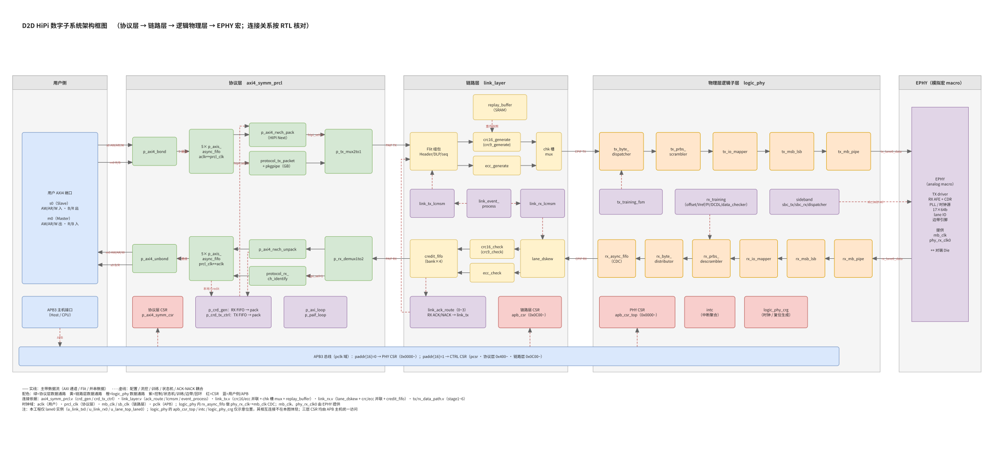

# OpenHappy

Die-to-Die (D2D) chiplet interconnect controller, implemented against the Chinese national
standard **GB/T 46280—2025 *Specification for chiplet interconnection interface***.

OpenHappy takes an AXI4 user interface, packs transactions into Flits, protects them with CRC/ECC,
carries them over a 17-IO parallel lane per die, and unpacks them on the peer die — so several
dies appear as one chip to software.



## Quick navigation

| I need to... | Section |
|---|---|
| See what is shipped and what state it is in | Status |
| Get the headline numbers (widths, clocks, CSR bus) | Key figures |
| Find a file | Repository layout |
| Build and run the smoke test | Quick start |
| Know which tool the RTL was developed with | Development tooling |
| Read the design, register map and bring-up flow | [docs/UserGuide.md](docs/UserGuide.md) |
| Integrate the RTL into my SoC | [docs/IntegrationGuide.md](docs/IntegrationGuide.md) |
| Know the current gaps | Known limitations |
| Know the license terms | License |

## Status

| Item | Value |
|---|---|
| Digital top | `d2d_hipi_dig_top` (protocol layer + link layer + logic PHY + controller CSR) |
| Shipped configuration | symmetric AXI4 1TX1RX, single physical lane (lane0) |
| Standard coverage | GB/T 46280.1–46280.4 (general, protocol layer, data link layer, 2D-package PHY); part 5 (2.5D package) not covered |
| Verification | `smoke_1wr1rd` passing at all three loopback levels (`phys` / `paif` / `cpif`) |
| Analog PHY | not included; empty stubs only (`d2d_ana_top_stub.sv`, `phy_model_stub.sv`) |

## Key figures

| Parameter | Value |
|---|---|
| AXI4 data / ID / address width | 512 bit / 10 bit / 64 bit |
| PAIF width (protocol layer <-> link layer) | 512 bit |
| CPIF width (link layer <-> logic PHY) | 1024 bit |
| Physical IO per lane | 17 (16 data + 1 redundant) x 64 bit |
| Serialization ratio | 32:1 |
| Main-band clocks (`mb_clk`, `phy_rx_clk0`, `aclk`, `pclk`) | 1 GHz target |
| Sideband clocks (`sb_tx_clk_in`, `sb_tx_clk`, `sb_rx_clk`) | 800 MHz target |
| Flit protection | CRC9 per Flit, CRC16 and ECC in the link layer |
| Configuration bus | APB3, 20-bit address, two CSR domains (logic PHY / controller) |

## Repository layout

```text
OpenHappy/
├── README.md                  this file
├── AGENTS.md                  contributor / agent operating manual and invariants
├── LICENSE                    verbatim PolyForm Free Trial 1.0.0 + Additional Terms
├── NOTICE                     copyright, commercial-license path, third-party and tooling notes
├── docs/
│   ├── UserGuide.md           design, register map, bring-up, test cases, FAQ
│   ├── IntegrationGuide.md    SoC integration guide (step-by-step)
│   ├── architecture/          block diagrams (drawio source, svg/png exports, edit link)
│   └── assets/snapshot/       reference waveform screenshots
├── code/                      RTL (HIPINEXT_HOME)
│   ├── design/filelist/       filelists; d2d_hipi_dig_top.f is the RTL entry
│   ├── design/rtl_v/          RTL sources (top, pcsr, protocol_layer, link_layer, logic_phy)
│   ├── common/                common library incl. xl_std_cell generic_* wrappers
│   └── hardip/sram/           hand-written SRAM behavioral model
├── verify/                    verification environment (D2D_HIPI_DV_HOME)
│   ├── Makefile, env.sh       build / run / regress / waveform entry points
│   ├── filelist/              full TB filelist (RTL + hard IP + TB)
│   ├── tb/, vip/, env/, seq/, test/, script/
└── sim/<TEST>/                generated: obj_dir, logs, optional VCD (git-ignored)
```

## Quick start

Requirements: Verilator **>= 5.000** (`--binary` and `--timing` are required), GNU Make, a C++14
compiler; GTKWave only if you want to look at waveforms. No vendor simulator, no PDK, no license
manager.

```bash
cd verify
make run TEST=smoke_1wr1rd            # compile + simulate; expect "TEST RESULT: PASS"
make regress                          # same case at phys / paif / cpif loopback levels
make run TEST=smoke_1wr1rd DUMP=1     # also write sim/smoke_1wr1rd/smoke_1wr1rd.vcd
make waves TEST=smoke_1wr1rd          # open that VCD in GTKWave (GTKWave not installed on this host)
make help                             # all targets and variables
```

The Makefile derives every path from its own location, so no environment setup is needed;
`source verify/env.sh` exports the same variables (`PROJ_HOME`, `HIPINEXT_HOME`,
`D2D_HIPI_DV_HOME`, `D2D_SIM_HOME`) for standalone tool runs.

Expected output tail:

```text
1013000 [BASE] smoke_1wr1rd: PASS (axi errors=0, scb mismatch=0)
 TEST RESULT: PASS  (checks=0, errors=0)
```

Measured on this tree: Verilator 5.050, full rebuild plus simulation of `smoke_1wr1rd` takes about
90 s; `make regress` (three loopback levels) completes in about 260 s with three `PASS` results.

## Development tooling

This project was developed with **BabelPro**, the closed-source professional edition of the
open-source **Babel** project. BabelPro is not part of this repository and is not required to build,
simulate or integrate the RTL — everything here builds with the tools listed in Quick start.

## Documentation

| Document | Contents |
|---|---|
| [docs/UserGuide.md](docs/UserGuide.md) | Standard mapping, architecture, interfaces, register map, reset/init sequence, loopback levels, test cases and PASS criteria, FAQ |
| [docs/IntegrationGuide.md](docs/IntegrationGuide.md) | Integrating the RTL into an SoC: ports, clocks/resets, APB bring-up, AXI rules, filelists, analog PHY boundary, checklist |
| [AGENTS.md](AGENTS.md) | Layout, invariants, build/debug/test commands, documentation rules |

## Known limitations

- **Training** is bypassed by default (`TRAIN_MODE=3`): the RX training FSM is a three-state shell
  stub, so the automatic training flow (`TRAIN_MODE=0`) does not bring the link up yet.
- **One physical lane only** (lane0); the single-lane shape is fixed by
  `code/design/rtl_v/top/hipi_top_defines.vh`.
- **No analog PHY**: `d2d_ana_top_stub.sv` (450 pins) and `phy_model_stub.sv` (242 pins) are empty
  shells for elaboration only; functional link behaviour needs a real EPHY model or silicon.
- **`remote_loop`** (bond-layer loopback) needs two dies driving each other; the shipped TB is a
  single-DUT port-level loopback and the Makefile rejects `LOOPBACK=axi`.
- **`SBC_LANE_ENABLE`** reads back `0xF` although `0x1` is written (hard-coded in the generated
  register file); the testbench downgrades it to a warning.
- **No conformance certification**: the block is designed against GB/T 46280—2025 parts 1-4, but no
  conformance assessment has been performed, and some features (256 B Flit performance mode,
  10-bit AXI IDs, several CSR fields) are project extensions outside the standard.
- **No synthesis / timing / power flow** is part of this repository; no such numbers are claimed.

## License

**Source-available, not open source.** This project is licensed under the **PolyForm Free Trial
License 1.0.0** — [LICENSE](LICENSE) holds the license as one document: Part I reproduces the
verbatim, unmodified PolyForm text and Part II adds conditions that prevail over it; and
[NOTICE](NOTICE) holds the copyright line, the commercial-license path and the third-party and
tooling statements. In short:

- **Scope**: only the **source code** (`code/`, `verify/` with their filelists, macros, scripts and
  build files) and the **design documents** (`docs/` plus the root documents) are licensed. The
  standard and the protocol/interface/register/pin definitions it describes, ideas and methods, your
  own designs/RTL/software, and any simulation, synthesis or fabrication outputs are **not** licensed
  material.
- **Free trial**: you may use the software, including to evaluate whether it suits a particular
  application, for **less than 32 consecutive calendar days**.
- **No distribution**: you may not distribute copies of the software or of works based on it.
- **Commercial / production use requires a separate written license** from OpenHappy Team. Contact
  the team to obtain one; this repository has no public ordering channel.
- **Patent license included**: the license text grants a patent license (§Patent License) covering
  patent claims the licensor can license or becomes able to license and that you would infringe by
  using the software. It ends immediately if you assert that the software infringes a patent
  (§Patent Defense).
- **No modification without prior written authorization**: Part II of `LICENSE` withdraws the
  "Changes and New Works License" unless OpenHappy Team has authorized you in writing — this covers
  local bug fixes and RTL/testbench changes too — and vests all IP in authorized modifications and
  derivatives (copyright, patents, utility models, mask-work rights) in OpenHappy Team on creation.
  Configuring a local copy to run the flow (environment variables, tool-path and viewer variables,
  existing make/script arguments) is explicitly permitted and is not a modification. Your own
  pre-existing specifications, testbenches and integration code are unaffected.

The RTL is an independent implementation: it contains no vendor PDK cells and no vendor SRAM/PHY
simulation models. Copyright headers of the original internal sources were removed as part of this
source release. The three generated register files (`logic_phy/apb_csr_top_rf.v`,
`link_layer/link_layer_rf.v`, `link_layer/link_layer_apb_reg_sync.v`) carry a neutral "generated, do
not edit" note instead of their original generator header; regenerating them restores that header,
so re-apply the neutralization afterwards (see `AGENTS.md` §8).
