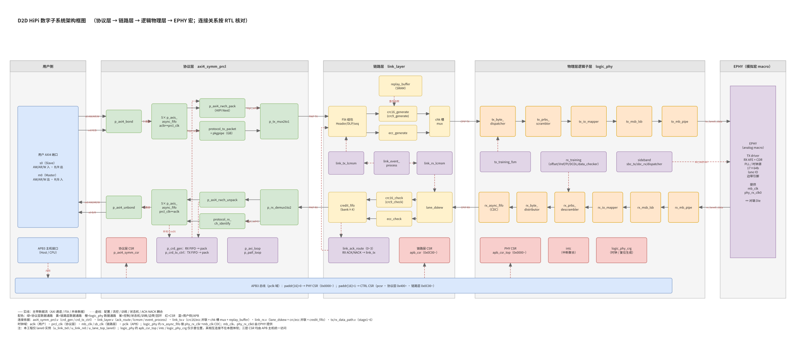
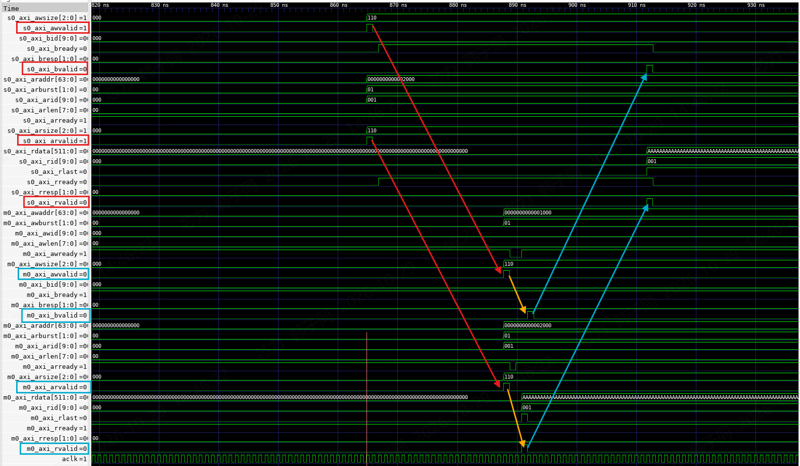
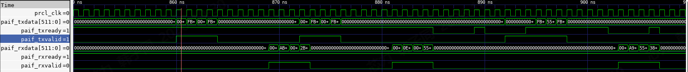
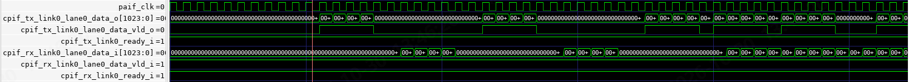
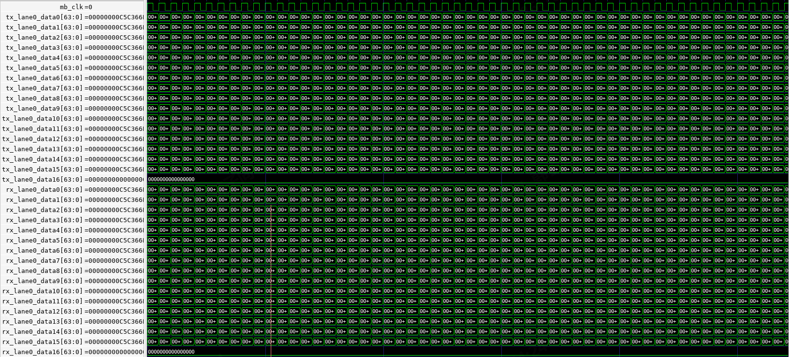

# D2D HiPi User Guide

> Project: `OpenHappy` — a self-contained D2D HiPi 1TX1RX symmetric AXI4 protocol-layer project
> Version: v1.0 (initial release) | Date: 2026-10-30 | Author: OpenHappy Team
> Applicable RTL: `code/design/rtl_v/top/d2d_hipi_dig_top.v`
>
> **This project is designed according to the national standard series GB/T 46280—2025 *Specification for chiplet interconnection interface***; see §1.1.1 for details.
>
> This project is a 1TX1RX symmetric AXI4 protocol-layer digital logic subset, delivered self-contained: RTL sources, the verification environment
> (Verilator + GTKWave), and the build / simulation / waveform scripts are all inside this package, ready to run out of the box.

---

## Table of Contents

  - [Table of Contents](#table-of-contents)
- [Part 1: Design Overview](#part-1-design-overview)
  - [1.1 Background and Application Scenarios](#11-background-and-application-scenarios)
    - [Typical Application Scenarios](#typical-application-scenarios)
    - [1.1.1 Standard Basis (GB/T 46280—2025)](#111-standard-basis-gbt-462802025)
    - [Forms Covered by This Project](#forms-covered-by-this-project)
    - [Key Design Metrics (This Project Configuration)](#key-design-metrics-this-project-configuration)
  - [1.2 Architecture Composition](#12-architecture-composition)
    - [1.2.1 Hierarchy](#121-hierarchy)
    - [1.2.2 Data Path](#122-data-path)
    - [1.2.3 Loopback Mechanisms (for verification)](#123-loopback-mechanisms-for-verification)
  - [1.3 Feature List](#13-feature-list)
    - [Protocol Layer (axi4_symm_prcl)](#protocol-layer-axi4_symm_prcl)
    - [Link Layer (link_layer)](#link-layer-link_layer)
    - [Physical Layer (logic_phy)](#physical-layer-logic_phy)
    - [Integration](#integration)
  - [1.4 Main Interface Signals](#14-main-interface-signals)
    - [1.4.1 Port Counts](#141-port-counts)
    - [1.4.2 Clocks](#142-clocks)
    - [1.4.3 Resets (all asynchronous, active low)](#143-resets-all-asynchronous-active-low)
    - [1.4.4 APB Configuration Interface](#144-apb-configuration-interface)
    - [1.4.5 AXI4 User-Side Interface](#145-axi4-user-side-interface)
    - [1.4.6 Mainband Data Interface (TX / RX lane)](#146-mainband-data-interface-tx--rx-lane)
    - [1.4.7 Sideband Interface (SBC)](#147-sideband-interface-sbc)
    - [1.4.8 Interrupts and Status](#148-interrupts-and-status)
    - [1.4.9 Others](#149-others)
- [Part 2: Initialization Flow](#part-2-initialization-flow)
  - [2.1 Register Space Partitioning](#21-register-space-partitioning)
    - [2.1.1 Top-Level APB Address Segmentation](#211-top-level-apb-address-segmentation)
    - [2.1.2 Address Notation from the TB Perspective](#212-address-notation-from-the-tb-perspective)
  - [2.2 Register Description by Segment](#22-register-description-by-segment)
    - [2.2.1 pcsr Segment (`0x1_0000`, TB offset `0x000` ~)](#221-pcsr-segment-0x1_0000-tb-offset-0x000-)
    - [2.2.2 prcl Segment (`0x1_0400`, TB offset `0x400` ~)](#222-prcl-segment-0x1_0400-tb-offset-0x400-)
    - [2.2.3 link Segment (`0x1_0C00`, TB offset `0xC00` ~)](#223-link-segment-0x1_0c00-tb-offset-0xc00-)
    - [2.2.4 logic_phy Segment (`0x0_0000`)](#224-logic_phy-segment-0x0_0000)
  - [2.3 Reset Semantics and Release Order](#23-reset-semantics-and-release-order)
    - [2.3.1 Reset Classification](#231-reset-classification)
    - [2.3.2 Release Order (critical)](#232-release-order-critical)
  - [2.4 Initialization Configuration Steps (Phase 0~4)](#24-initialization-configuration-steps-phase-04)
    - [Phase 0 — Clocks and Reset](#phase-0--clocks-and-reset)
    - [Phase 1 — Common Control (pcsr)](#phase-1--common-control-pcsr)
    - [Phase 2 — Physical Layer (logic_phy)](#phase-2--physical-layer-logic_phy)
    - [Phase 3 — Link Layer (link_layer)](#phase-3--link-layer-link_layer)
    - [Phase 4 — Protocol Layer (prcl)](#phase-4--protocol-layer-prcl)
    - [2.4.x Complete Configuration Checklist (quick reference)](#24x-complete-configuration-checklist-quick-reference)
    - [2.4.y Initialization Flow Diagram](#24y-initialization-flow-diagram)
  - [2.5 Completion Criteria](#25-completion-criteria)
    - [How the Verification Environment Probes](#how-the-verification-environment-probes)
- [Part 3: Deliverables and Verification Environment](#part-3-deliverables-and-verification-environment)
  - [3.1 Directory Structure](#31-directory-structure)
  - [3.2 Environment Variables](#32-environment-variables)
    - [How to Set Them (choose one)](#how-to-set-them-choose-one)
    - [3.2.1 EDA Tool Notes](#321-eda-tool-notes)
  - [3.3 Compile / Simulate / Waveform Commands](#33-compile--simulate--waveform-commands)
    - [3.3.1 Basics](#331-basics)
    - [3.3.2 Makefile Targets at a Glance](#332-makefile-targets-at-a-glance)
    - [3.3.3 Makefile Variables at a Glance](#333-makefile-variables-at-a-glance)
    - [3.3.4 Common Commands (TRAIN_BYPASS Required)](#334-common-commands-train_bypass-required)
    - [3.3.5 Running Locally (script wrappers)](#335-running-locally-script-wrappers)
    - [3.3.6 Viewing Waveforms (GTKWave / VCD)](#336-viewing-waveforms-gtkwave--vcd)
    - [3.3.7 Reference Waveforms](#337-reference-waveforms)
  - [3.4 Conditional compilation: loopback levels](#34-conditional-compilation-loopback-levels)
    - [3.4.1 Three loopback levels](#341-three-loopback-levels)
    - [3.4.2 Request path of the three levels](#342-request-path-of-the-three-levels)
    - [3.4.3 Note: no axi level is provided (remote_loop applies to dual die only)](#343-note-no-axi-level-is-provided-remote_loop-applies-to-dual-die-only)
  - [3.5 Other compile switches](#35-other-compile-switches)
    - [3.5.1 `TRAIN_BYPASS` (the most critical switch in this project)](#351-train_bypass-the-most-critical-switch-in-this-project)
    - [3.5.2 `DUMP`](#352-dump)
    - [3.5.3 RTL macro configuration (hipi_top_defines.vh)](#353-rtl-macro-configuration-hipi_top_definesvh)
  - [3.6 TB composition and connection block diagram](#36-tb-composition-and-connection-block-diagram)
  - [3.7 Simulation models of PDK cells and SRAM](#37-simulation-models-of-pdk-cells-and-sram)
    - [3.7.1 Standard cells (std cell, xl_std_cell/)](#371-standard-cells-std-cell-xl_std_cell)
    - [3.7.2 SRAM behavioral model (sram_1rw_128b.v)](#372-sram-behavioral-model-sram_1rw_128bv)
- [Part 4: Test Cases](#part-4-test-cases)
  - [4.1 Case List](#41-case-list)
  - [4.2 smoke_1wr1rd Stimulus Introduction](#42-smoke_1wr1rd-stimulus-introduction)
    - [4.2.1 Design Intent](#421-design-intent)
    - [4.2.2 Execution Sequence](#422-execution-sequence)
    - [4.2.3 Stimulus Parameters](#423-stimulus-parameters)
    - [4.2.4 VIP Behavior](#424-vip-behavior)
  - [4.3 PASS Criteria](#43-pass-criteria)
    - [4.3.1 Decision Formula](#431-decision-formula)
    - [4.3.2 Item-by-Item Criteria](#432-item-by-item-criteria)
    - [4.3.3 Summary of Criteria Sources](#433-summary-of-criteria-sources)
    - [4.3.4 Measured Results (current release, Verilator environment)](#434-measured-results-current-release-verilator-environment)
  - [4.4 Logs and Waveforms](#44-logs-and-waveforms)
    - [4.4.1 Log Files](#441-log-files)
    - [4.4.2 Key Log Excerpts](#442-key-log-excerpts)
    - [4.4.3 Waveform Capture](#443-waveform-capture)
    - [4.4.4 Waveform Export (GTKWave)](#444-waveform-export-gtkwave)
  - [Appendix A: FAQ](#appendix-a-faq)
    - [Q1: `make run` reports `COMPILE_FAIL`](#q1-make-run-reports-compile_fail)
    - [Q2: Simulation reports `AW handshake TIMEOUT`](#q2-simulation-reports-aw-handshake-timeout)
    - [Q3: `SBC_LANE_ENABLE` reads back 0xF instead of 0x1](#q3-sbc_lane_enable-reads-back-0xf-instead-of-0x1)
    - [Q4: Steps to Add a New Case](#q4-steps-to-add-a-new-case)
    - [Q5: Simulation Speed-Up Methods](#q5-simulation-speed-up-methods)
---

# Part 1: Design Overview

## 1.1 Background and Application Scenarios

**D2D HiPi** (Die-to-Die High Performance Interface) is a low-latency, high-bandwidth die-to-die interconnect interface aimed at **chiplet / multi-die integration**. After one large chip is split into several small dies, short-distance parallel buses connect them so that the multiple dies appear as one chip from the software perspective.

### Typical Application Scenarios

| Scenario | Description |
|---|---|
| **Chiplet partitioning** | A SoC is partitioned by function into compute die / IO die / memory die and assembled into a large chip through D2D, improving yield and reducing cost |
| **2.5D / silicon interposer** | Multiple dies are placed on the same silicon interposer; D2D runs over interposer routing, with distances on the order of cm |
| **3D stacking** | Dies are stacked vertically; D2D runs over TSV / hybrid bonding, with distances on the order of µm |
| **Multi-die coherent interconnect** | Carries CPU die ↔ CPU die cache-coherent traffic (AXI4 semantics pass-through) |

### 1.1.1 Standard Basis (GB/T 46280—2025)

This project is designed against **the national standard GB/T 46280—2025 *Specification for chiplet interconnection interface***.

> **Conformance note**: this is an engineering implementation of a subset of the standard. No
> conformance assessment or certification against GB/T 46280 has been performed, and some features
> are project extensions outside the standard (see the note at the end of this section).

The standard is issued by the Standardization Administration of China, **published on 2025-08-19 and effective from 2026-03-01**, and consists of 5 parts:

| Standard number | Name | English name | Implementation in this project |
|---|---|---|---|
| **GB/T 46280.1—2025** | Part 1: **General principles** | Part 1: General principles | Overall layered architecture (protocol layer / data link layer / physical layer), terms and abbreviations, bandwidth application modes, interconnect scenarios, package types |
| **GB/T 46280.2—2025** | Part 2: **Protocol layer technical requirements** | Part 2: Protocol layer technical requirements | `axi4_symm_prcl` — AXI4.0 bus protocol transport, CN (traffic channel number) definition, ADDR/WDATA/RDATA/WRSP channel widths and packing formats |
| **GB/T 46280.3—2025** | Part 3: **Data link layer technical requirements** | Part 3: Data link layer technical requirements | `link_layer` — Flit format (Header/Tail/NULL/ARQ), CRC9 check (`x⁹+x⁵+x⁴+x+1`, all-ones seed, §6.2.2), retransmission (Standard NACK / Select NACK), link initialization state machine (§6.7 Figure 9), PAIF (§8.1 Table 12) / CPIF (§8.2 Table 13) interfaces |
| **GB/T 46280.4—2025** | Part 4: **Physical layer technical requirements based on 2D package** | Part 4: Physical layer technical requirements based on 2D package | `logic_phy` — logic sublayer / electrical sublayer, lane training and calibration, scrambling and descrambling, CPIF data distribution ("LSB first", Tables 19/21), sideband forwarded clock (§7.3.1) |
| **GB/T 46280.5—2025** | Part 5: Physical layer technical requirements based on 2.5D package | Part 5: Physical layer technical requirements based on 2.5D package | **Not covered by this project** (this project takes the 2D package form and follows Part 4) |

#### Layered Architecture (GB/T 46280.1—2025 §5)

```
┌────────────────────────────────────────────────┐        ┌────────────────────────────────────────────────┐
│                   Chiplet A                    │        │                   Chiplet B                    │
│  ┌──────────────────────────────────────────┐  │        │  ┌──────────────────────────────────────────┐  │
│  │           Protocol Layer (PL)            │  │        │  │           Protocol Layer (PL)            │  │
│  │Bus adapter unit + HAI custom unit        │  │        │  │Bus adapter unit + HAI custom unit        │  │
│  └──────────────────────────────────────────┘  │        │  └──────────────────────────────────────────┘  │
│                     ↕ PAIF                     │        │                     ↕ PAIF                     │
│  ┌──────────────────────────────────────────┐  │  Flit  │  ┌──────────────────────────────────────────┐  │
│  │          Data Link Layer (DLL)           │  │  Flit  │  │          Data Link Layer (DLL)           │  │
│  │CRC/ECC check · Retransmit · FSM          │  │◄──────►│  │CRC/ECC check · Retransmit · FSM          │  │
│  └──────────────────────────────────────────┘  │        │  └──────────────────────────────────────────┘  │
│                     ↕ CPIF                     │        │                     ↕ CPIF                     │
│  ┌──────────────────────────────────────────┐  │  Bits  │  ┌──────────────────────────────────────────┐  │
│  │           Physical Layer (PHY)           │  │  Bits  │  │           Physical Layer (PHY)           │  │
│  │Logic sublayer + electrical sublayer      │  │◄──────►│  │Logic sublayer + electrical sublayer      │  │
│  └──────────────────────────────────────────┘  │        │  └──────────────────────────────────────────┘  │
└────────────────────────────────────────────────┘        └────────────────────────────────────────────────┘
              Package (2D Package)
```

> **Interface layering**: the protocol layer ↔ data link layer uses **PAIF** (Protocol Adapter Interface); the data link layer ↔ physical layer uses **CPIF** (Chiplet PHY Interface). Both interface names and abbreviations come from GB/T 46280.1—2025 §5.1.

#### Correspondence Between This Project and the Standard

| Standard requirement | Implementation in this project | Notes |
|---|---|---|
| Part 2 §5: support for the AXI4.0/3.0 bus protocol | `axi4_symm_prcl` | Packed transport of the five AXI4 channels (AW/AR/W/R/B) |
| Part 2 §5: multi-protocol bus transfer arbitration, data buffering | `p_axi4_bond` / `p_axi4_unbond` / TX-RX FIFO | —— |
| Part 3 §6.1: Flit data format | `link_tx` / `link_rx` | Header / Tail / NULL / ARQ Flit |
| Part 3 §6.2.2: CRC9 check | `crc9_generate` / `crc9_check` | `x⁹+x⁵+x⁴+x+1`, all-ones seed |
| Part 3 §6.7 Figure 9: link initialization | `link_tx_lcmsm` / `link_rx_lcmsm` | 6-state machine, encoding = `STATUS_REG.LINK_FSM_STATE` |
| Part 3 §8.1 Table 12: PAIF interface | PAIF (512 / 1024 bit) | See §1.2.2 data path |
| Part 3 §8.2 Table 13: CPIF interface | CPIF (1024 bit) | See §1.2.2 data path |
| Part 4 §5.2: data distribution "LSB first" | `tx_io_mapper` / `rx_io_mapper` | MSB/LSB swap used to compensate for reversed PCB routing |
| Part 4 §7.3.1: sideband forwarded clock | `sideband.sbc_tx` gating produces `sb_tx_clk` | Toggles only while a message is present, held low between messages |
| Part 4: lane training and calibration | `train/` (offset / Vref / PI / DCDL / data_check) | —— |

> **Project extensions (outside the standard)**: the performance-mode 256 B Flit format, the 10-bit AXI ID width (the standard recommends 8 bit), and some CSR fields are custom extensions of this project and do not fall within the scope of GB/T 46280—2025.

### Forms Covered by This Project

This project is a subset of D2D HiPi in **1TX1RX symmetric mode**:

- Protocol layer: `axi4_symm_prcl` (symmetric AXI4, peer-to-peer transmit and receive)
- Physical layer: **single lane** (lane0, TX + RX bidirectional)
- Top-level DUT: `d2d_hipi_dig_top` (pure digital, no analog PHY)

### Key Design Metrics (This Project Configuration)

| Item | Value |
|---|---|
| AXI4 user-side data width | 512 bit |
| AXI4 ID / Addr width | 10 / 64 bit |
| PAIF data width | **512** bit |
| CPIF data width | **1024** bit |
| Physical IOs per lane | 17 (16 data + 1 redundant), 64 bit per IO |
| Mainband clocks `mb_clk` / `phy_rx_clk0` / `aclk` / `pclk` | 1 GHz |
| Sideband clocks `sb_tx_clk_in` / `sb_rx_clk` | 800 MHz |
| Serial-to-parallel ratio | 32:1 |

## 1.2 Architecture Composition

**Overall architecture block diagram** (four layers: protocol layer → link layer → logic PHY → EPHY analog macro; box names are the RTL module names,
and every connection has been checked against `code/design/rtl_v`):



> Figure source: `architecture/d2d_hipi_arch.drawio` (editable with draw.io, including a diagrams.net online edit link
> at `architecture/d2d_hipi_arch_edit_url.txt`). The figure shows:
> ① the data path of every layer (protocol layer bond/FIFO/pack/mux; link layer Flit assembly/CRC/ECC parallelism/chk slot mux/replay_buffer;
> logic_phy's tx_data_path / rx_data_path stage by stage);
> ② the control and flow-control side paths (Credit, ACK/NACK routing, link state machines and events, training and sideband);
> ③ **independent CSR per layer** (protocol layer `0x400~` / link layer `0x0C00~` / PHY `0x0000~`) accessed uniformly by the **APB host**;
> see §2.1.1 for the address segmentation.
>
> The next subsection gives the text version of the same hierarchy (§1.2.1) and the data path description (§1.2.2).

### 1.2.1 Hierarchy

```
d2d_hipi_dig_top (digital top level, DUT of this project)
├── hipi_ctrl_top  u_hipi_ctrl_top                         Controller subsystem
│   ├── pcsr                                               common CSR (reset / clock enable)
│   ├── axi4_symm_prcl                                     * protocol layer (1TX1RX symmetric AXI4)
│   │   ├── p_axi4_bond                                    user AXI → bond bus aggregation
│   │   ├── p_axi_loop                                     bond-layer remote loopback
│   │   ├── p_paif_loop                                    PAIF-layer local loopback
│   │   ├── p_axi4_rwch_pack                               AW/AR/W packing
│   │   ├── p_axi4_rwch_unpack                             AW/AR/W unpacking
│   │   ├── p_axi4_rch_pack                                R/B packing
│   │   ├── p_axi4_rch_unpack                              R/B unpacking
│   │   ├── p_axi4_unbond                                  bond bus → user AXI
│   │   ├── p_crd_gen / p_crd_tx_ctrl                      Credit generation / gating
│   │   ├── p_req_timeout                                  request timeout monitor
│   │   └── p_axis_async_fifo                              PAIF async FIFO
│   └── link_layer  u_link_layer                           link layer
│       ├── link_tx / link_rx                              transmit / receive (512/1024 lane1/2 variants)
│       ├── replay_buffer                                  replay buffer (8 × 128bit × 32-deep SRAM)
│       ├── credit_fifo                                    credit FIFO
│       ├── crc9/crc16/ecc                                 checksum generation and checking
│       ├── lane_dskew                                     lane deskew
│       └── link_tx_lcmsm / link_rx_lcmsm                  link control state machine
├── logic_phy  u_logic_phy                                 logic PHY
│   ├── lane_top_lane0
│   │   ├── tx_chain                                       TX: mb_pipe → msb_lsb → io_mapper → prbs → distribution
│   │   ├── rx_chain                                       RX: mb_pipe → msb_lsb → io_mapper → prbs → distribution
│   │   ├── tx_training_fsm                                TX training state machine
│   │   └── rx_training_fsm                                RX training state machine
│   ├── sideband                                           sideband (SBC TX/RX/Dispatcher/CPIF event)
│   ├── train/                                             training unit (offset / Vref / PI / DCDL / data_check)
│   ├── apb_csr_top                                        PHY CSR register file
│   ├── intc                                               interrupt aggregation
│   └── logic_phy_crg                                      clock/reset generation
└── (integration connect logic)                            CPIF width mapping / direct APB / interrupt aggregation
```

### 1.2.2 Data Path

**Transmit direction (TX)**

```
User AXI s0_axi (AW/AR/W)
  → axi4_symm_prcl: p_axi4_bond aggregates into the bond bus
  → p_axi_loop (pass-through)
  → TX FIFO + p_crd_tx_ctrl (credit gating)
  → p_axi4_rwch_pack packing
  → PAIF (512 bit)
  → link_layer: link_tx (CRC / ECC / replay buffer)
  → CPIF (1024 bit)
  → logic_phy: tx_chain (serialize 32:1)
  → tx_lane0_data0~16 (17 × 64 bit)
```

**Receive direction (RX)**

```
rx_lane0_data0~16 (17 × 64 bit)
  → logic_phy: rx_chain (deserialize 32:1)
  → CPIF (1024 bit)
  → link_layer: link_rx (CRC check / deskew / reordering)
  → PAIF (512 bit)
  → axi4_symm_prcl: p_axi4_rwch_unpack unpacking
  → RX FIFO
  → p_axi_loop (pass-through)
  → p_axi4_unbond splits into the bond bus
  → User AXI m0_axi (R/B responses)
```

### 1.2.3 Loopback Mechanisms (for verification)

| Loopback layer | Register | Mechanism | Coverage |
|---|---|---|---|
| **Physical layer** | none (direct TB port connection) | `tx_lane0_dataN → rx_lane0_dataN` (17×64bit) + sideband loopback | full link |
| **CPIF layer** | link `0x0C14` bit16 | `link_tx` CPIF TX egress → `link_rx` CPIF RX ingress | protocol layer + link layer |
| **PAIF layer** | prcl `0x500` bit0 | `p_paif_loop`: pack TX → unpack RX (`s0→m1`) | protocol layer only |
| **bond layer** | prcl `0x500` bit1 | `p_axi_loop`: peer RX data fed back to TX (`s1→m0`) | requires two dies driving each other |

## 1.3 Feature List

### Protocol Layer (axi4_symm_prcl)

- ✅ Full AXI4 channel support (AW/AR/W/R/B), concurrent read and write
- ✅ 10-bit ID width, out-of-order responses supported
- ✅ 512-bit data width, INCR / WRAP / FIXED bursts supported
- ✅ Pack / unpack: compress the five AXI channels into a unified bond bus transfer
- ✅ Credit flow control (`p_crd_gen` / `p_crd_tx_ctrl`), enable is configurable
- ✅ Request timeout monitoring (`p_req_timeout`), timeout threshold is configurable
- ✅ Two loopback levels: local loopback at the PAIF layer, remote loopback at the bond layer
- ✅ Interrupt and status registers (lane idle / timeout id / error id / mask)

### Link Layer (link_layer)

- ✅ Flit-level CRC9 / CRC16 checking
- ✅ ECC protection (`ecc_generate` / `ecc_check`)
- ✅ Retransmission mechanism (`replay_buffer` + credit protocol)
- ✅ Lane deskew (`lane_dskew`)
- ✅ Link control state machines (`link_tx_lcmsm` / `link_rx_lcmsm`)
- ✅ Low-power states (LP_STATE: U0 etc.)
- ✅ Error injection (for robustness verification)
- ✅ Configurable lane count (512 / 1024-bit width variants, 1 / 2-lane variants)

### Physical Layer (logic_phy)

- ✅ Single lane (lane0, TX+RX bidirectional), 17 IO × 64 bit
- ✅ 32:1 serialization / deserialization
- ✅ PRBS scrambling / descrambling (configurable)
- ✅ Sideband channel (SBC): TX / RX / Dispatcher / CPIF event
- ✅ Electrical training: offset / Vref / PI / DCDL / data check
- ✅ Training modes: automatic full flow / simplified / manual single-step / bypass
- ✅ Interrupt aggregation (`intc`)

### Integration

- ✅ 5 independent asynchronous resets (`presetn` / `aresetn` / `mb_rst_n` / `sb_rst_n` / `mcu_rst_n`)
- ✅ APB3 configuration bus, 20-bit address, dual domain (phy / ctrl)
- ✅ Interrupt outputs: `irq_ext` (PHY aggregate) / `hipi_ctrl_intr` (Controller aggregate)
- ✅ dfx status output (32 bit)

## 1.4 Main Interface Signals

### 1.4.1 Port Counts

Counted after preprocessing `d2d_hipi_dig_top.v` with the shipped macro set
(`hipi_top_defines.vh`: `PRCL_AXI` defined, single lane, no MCU subsystem), so inactive
`ifdef` branches are excluded:

| Direction | Count |
|---|---|
| `input` | 165 |
| `output` | 218 |
| `inout` | 17 |
| **total** | **400** |

Other configurations (CXS protocol layer, extra lanes, MCU subsystem) add further ports; take the
number from your own elaboration of `code/design/rtl_v/top/d2d_hipi_dig_top.v`.

### 1.4.2 Clocks

| Signal | Direction | Frequency | Description |
|---|:--:|---|---|
| `pclk` | in | 1 GHz | APB configuration clock (→ ctrl.pclk + logic_phy.apb_pclk + logic_phy.mcu_clk) |
| `mb_clk` | in | 1 GHz | TX mainband clock (provided by the analog PHY) |
| `phy_rx_clk0` | in | 1 GHz | lane0 RX recovered clock (provided by the analog PHY) |
| `aclk` | in | 1 GHz | AXI4 user-side interface clock (`PRCL_AXI` branch) |
| `sb_tx_clk_in` | in | 800 MHz | Sideband transmit clock source |
| `sb_tx_clk` | **out** | 800 MHz | Sideband transmit forwarded clock (gated output) |
| `sb_rx_clk` | in | 800 MHz | Sideband receive clock (forwarded by the peer side) |
| `pll_lock` | in | — | Analog PHY PLL lock status (driven by the TB) |

> `cxs_clk` / `cxs_rstn` are **not** ports of this build: they exist only in the non-`PRCL_AXI`
> (CXS) branch of the top-level port list.

### 1.4.3 Resets (all asynchronous, active low)

| Signal | Description | Release Timing |
|---|---|---|
| `presetn` | APB / configuration domain | **first** |
| `mb_rst_n` | Mainband data domain (→ logic_phy) | after presetn |
| `sb_rst_n` | Sideband data domain (→ logic_phy) | same batch as mb_rst_n |
| `mcu_rst_n` | MCU domain (already synchronized to pclk) | after mb/sb |
| `aresetn` | AXI4 user side (protocol layer) | **last** |

### 1.4.4 APB Configuration Interface

| Signal | Width | Description |
|---|:--:|---|
| `hipi_apb_paddr` | 20 | Address; `[16]` = domain select (0=phy CSR / 1=ctrl CSR) |
| `hipi_apb_pwrite` | 1 | Write enable |
| `hipi_apb_psel` | 1 | Slave select |
| `hipi_apb_penable` | 1 | Transfer enable |
| `hipi_apb_pwdata` | 32 | Write data |
| `hipi_apb_prdata` | 32 | Read data |
| `hipi_apb_pready` | 1 | Transfer complete |
| `hipi_apb_pslverr` | 1 | Error response (unimplemented address / write to a read-only field) |
| `hipi_apb_pprot` | 3 | Protection type |

> **Address mapping**: `paddr[16]=0` → logic_phy CSR; `paddr[16]=1` → hipi_ctrl_top CSR

### 1.4.5 AXI4 User-Side Interface

**s0_axi (DUT as AXI Slave, receives user requests)** — 176 signals

| Channel | Signals |
|---|---|
| AW | `s0_axi_awid[9:0]` / `awaddr[63:0]` / `awlen[7:0]` / `awsize[2:0]` / `awburst[1:0]` / `awlock` / `awcache[3:0]` / `awprot[2:0]` / `awqos[3:0]` / `awregion[3:0]` / `awuser[3:0]` / `awvalid` / `awready` |
| W | `s0_axi_wdata[511:0]` / `wstrb[63:0]` / `wlast` / `wuser[3:0]` / `wvalid` / `wready` |
| B | `s0_axi_bid[9:0]` / `bresp[1:0]` / `buser[3:0]` / `bvalid` / `bready` |
| AR | `s0_axi_arid[9:0]` / `araddr[63:0]` / `arlen[7:0]` / `arsize[2:0]` / `arburst[1:0]` / `arlock` / `arcache[3:0]` / `arprot[2:0]` / `arqos[3:0]` / `arregion[3:0]` / `aruser[3:0]` / `arvalid` / `arready` |
| R | `s0_axi_rid[9:0]` / `rdata[511:0]` / `rresp[1:0]` / `rlast` / `ruser[3:0]` / `rvalid` / `rready` |

**m0_axi (DUT as AXI Master, returns responses / forwards requests)** — 176 signals, signal names as in s0 with the prefix `m0_axi_`

### 1.4.6 Mainband Data Interface (TX / RX lane)

| Signal Group | Direction | Width | Count | Description |
|---|:--:|:--:|:--:|---|
| `tx_lane0_data0` ~ `tx_lane0_data16` | out | 64 | 17 | lane0 TX parallel data (upper 32 bit padded with 0 in 32:1 mode) |
| `rx_lane0_data0` ~ `rx_lane0_data16` | in | 64 | 17 | lane0 RX parallel data |

> Of the 17 IOs, 16 carry data and 1 is a redundant IO. There are no separate lane clock ports:
> the lane TX clock is `mb_clk` and the lane RX clock is `phy_rx_clk0`, both supplied by the analog PHY.

### 1.4.7 Sideband Interface (SBC)

| Signal | Direction | Description |
|---|:--:|---|
| `sb_txd` | out | Sideband transmit serial data (synchronous to `sb_tx_clk`) |
| `sb_rxd` | in | Sideband receive serial data (synchronous to `sb_rx_clk`) |
| `sb_txr` | out | Sideband transmit redundant (P0-B redundant path) |
| `sb_rxr` | in | Sideband receive redundant |
| `sb_tx_clk` | out | Sideband transmit forwarded clock |

### 1.4.8 Interrupts and Status

| Signal | Direction | Description |
|---|:--:|---|
| `irq_ext` | out | logic_phy aggregate interrupt (active high) |
| `hipi_ctrl_intr` | out | Controller aggregate interrupt (protocol layer \| link layer) |
| `dfx_stat_o[31:0]` | out | DFX status output |

### 1.4.9 Others

| Signal Group | Count | Description |
|---|:--:|---|
| `udi_*` | 5 | UDI (User Defined Interface) bridge path, `CPIF_DATA_WIDTH` wide; 3 TX-side, 2 RX-side, all on lane0 |
| `lane0_RX[0:16]_OFFSET_CTRL_DATA` | 17 | `inout` analog-PHY lane offset-control data |
| `lp_ctrl_*` | 4 | Low-power control interface |
| `ahbs_*` | — | AHB slave (→ logic_phy mcu_subsys; `MCU_SUBSYS` is not defined in this project, so not detailed) |

---

# Part 2: Initialization Flow

## 2.1 Register Space Partitioning

### 2.1.1 Top-Level APB Address Segmentation

```
hipi_apb_paddr[19:0]
  ├─ paddr[16]=0 → logic_phy segment (base 0x0_0000)
  │    ├─ 0x0_0000 ~ 0x0_00FF  : common control / training (train_mode etc.)
  │    ├─ 0x0_0400 ~ 0x0_04FF  : PHY interrupt / status
  │    ├─ 0x0_0800 ~ 0x0_08FF  : sideband SBC
  │    └─ 0x0_0C00 ~          : ...
  └─ paddr[16]=1 → hipi_ctrl_top segment (base 0x1_0000)
       ├─ 0x1_0000 ~ 0x1_03FF  : pcsr segment (common CSR)
       ├─ 0x1_0400 ~ 0x1_07FF  : prcl segment (protocol layer)
       └─ 0x1_0C00 ~ 0x1_0FFF  : link segment (link layer)
```

### 2.1.2 Address Notation from the TB Perspective

The TB's `apb_write_ctrl` / `apb_read_ctrl` only write the **in-segment offset** (`paddr[15:0]`),
which the VIP's `hipi_apb_paddr[16]` domain select completes automatically:

| Domain | TB Offset Base | DUT Address |
|---|---|---|
| phy | `0x000` | `0x0_0000` (`paddr[16]=0`) |
| pcsr | `0x000` | `0x1_0000` (`paddr[16]=1`) |
| prcl | `0x400` | `0x1_0400` |
| link | `0xC00` | `0x1_0C00` |

## 2.2 Register Description by Segment

### 2.2.1 pcsr Segment (`0x1_0000`, TB offset `0x000` ~)

| Offset | Name | Reset | Description |
|---|---|---|---|
| `0x000` | `tie_high` control | — | Low 2 bit control `mb_rst_n` / `sb_rst_n`; readback `0x3` means the resets are released |
| `0x004` | `clk_en` | `0x0` | `tx_clken[0]` / `rx_clken[0]` (byte0); protocol-layer clock enable, write `0x11` |
| `0x008` | int_mask | — | Controller interrupt mask |
| `0x010` | Other | — | —— |

### 2.2.2 prcl Segment (`0x1_0400`, TB offset `0x400` ~)

| Offset | Name | Description |
|---|---|---|
| `0x400` | `LOOPBACK_MODE` low 2 bit | `bit0=local_loop` (PAIF), `bit1=remote_loop` (bond, unused in this project) |
| `0x428` | `timeout_en` | Request timeout monitoring enable, write 1 |
| `0x414` | `credit_en` | **Credit gating enable, write 1 (LAST STEP)** |
| `0x500` | Loopback / hipi_sel | `hipi_sel=0` (HIPI Next engine in this project) |
| `0x600` | Protocol select | bit0=0 → HIPI Next |

### 2.2.3 link Segment (`0x1_0C00`, TB offset `0xC00` ~)

| Offset | Name | Description |
|---|---|---|
| `0x000` | `PHY_MODE` | NRZ / 32:1, reset readback `0x1C` |
| `0x00C` | `MODE_REG` | `WORK+PAIF` (reset `0x0B`, readback `0x09`) |
| `0x010` | `CTRL_REG` | Set `TX_RST_N` / `RX_RST_N` to 1 |
| `0x014` | `LOOPBACK_CFG` | `bit16=LOOPBACK_EN` (write `0x0001_0000` for the cpif setting) |
| `0x018` | `RETRY_CFG` | Retransmission configuration (reset `0x0002_0207`) |
| `0x034` | `STATUS` | `bit7:4=LINK_FSM_STATE` (4=S_NORMAL), `bit0=phy_ready` |
| `0x004` | `CONFIG_DONE` etc. | bit0=LANE_ON, bit2=CONFIG_DONE, bit3=rx_ready, bit5=RETRAIN |

### 2.2.4 logic_phy Segment (`0x0_0000`)

| Offset | Name | Description |
|---|---|---|
| `0x000` | `train_mode` | `0`=automatic full flow, `3`=BYPASS (up and running on power-up); **this project must use 3** |
| `0x004` | `PHY_MODE / lane_num` | `[0]=0` (32:1), `[7:4]=1` (lane_num=1), `[15:14]=0` |
| `0x008` | `prbs_high32_clk_gate_en` | `[0]=1` |
| `0x824` | `SBC_LANE_ENABLE` | Readback is hard-coded to `0xF` (known legacy issue, TB degrades to WARN) |
| `0x41C` | `timeout_step_en` | Training / calibration timeout enable, write `0x7f` |
| `0x010` / `0x014` | int_mask | PHY interrupt mask |

## 2.3 Reset Semantics and Release Order

### 2.3.1 Reset Classification

| Reset | Domain | Description |
|---|---|---|
| `presetn` | APB | Configuration domain, **released first** |
| `mb_rst_n` | mainband | TX / RX datapath |
| `sb_rst_n` | sideband | sideband path |
| `mcu_rst_n` | MCU | synchronous to pclk; this project uses no MCU but keeps the release step |
| `aresetn` | AXI | protocol-layer user side, **released last** |

### 2.3.2 Release Order (critical)

```
presetn → mb_rst_n / sb_rst_n / mcu_rst_n → (PHY boot) → … → aresetn (protocol layer, last)
```

**`aresetn` MUST NOT be released early**: the protocol layer may only leave reset after the physical layer / link layer are ready; otherwise the initialization probes fail.

## 2.4 Initialization Configuration Steps (Phase 0~4)

Initialization is driven uniformly by `base.init()` in `verify/test/d2d_hipi_test_base.sv`, in the following order:

### Phase 0 — Clocks and Reset

- Generate 5 clocks (phase-offset from each other)
- Release `presetn` / `mb_rst_n` / `sb_rst_n` / `mcu_rst_n`; **hold `aresetn`** until Phase 4a

### Phase 1 — Common Control (pcsr)

```
pcsr 0x000 = 0x3     // mb_rst_n / sb_rst_n = 1 (release mainband / sideband reset)
pcsr 0x004 = 0x11    // tx_clken[0] + rx_clken[0] (protocol-layer clock enable)
```

### Phase 2 — Physical Layer (logic_phy)

```
phy 0x000 = 0x3      // train_mode=3: BYPASS (links up right after power-on; mandatory in this project)
phy 0x004 = 0x10     // PHY_MODE=0 (32:1), lane_num=1
phy 0x008 = 0x1      // prbs_high32_clk_gate_en
phy 0x41C = 0x7f     // timeout_step_en
phy 0x810/0x814/0x818 = ...  // SBC sideband enable / mask
phy 0x000 (retrain event)   // trigger the first training
```

> **Why BYPASS**: the RX training FSM is a **three-state shell stub**; the per-step training states have
> no transitions, so the automatic full flow (`train_mode=0`) stalls in training under PHY loopback and
> the link never comes up. BYPASS goes straight to ACTIVE / BRINGUP and is currently the only training
> mode that completes initialization and the datapath.

### Phase 3 — Link Layer (link_layer)

```
link 0x000 = 0x1C    // PHY_MODE = NRZ / 32:1
link 0x00C = 0x0B    // MODE_REG = WORK + PAIF
link 0x010 = 0x05    // TX_RST_N / RX_RST_N = 1 (link out of reset)
link 0x014 = (loopback profile LOOPBACK_EN)  // cpif writes bit16; phys/paif write 0
link 0x018 = 0x0002_0207  // RETRY_CFG (reset default)
link 0x004 = ...     // trigger RETRAIN (training event), wait for S_NORMAL
```

### Phase 4 — Protocol Layer (prcl)

```
[4a] esc_prcl_reset():  release aresetn (protocol-layer user-side reset, LAST)
[4b] prcl_config():
      prcl 0x500 = 0x0      // hipi_sel=0 → HIPI Next engine
      prcl 0x428 = 0x1      // timeout_en
      prcl 0x414 = 0x1      // credit_en (LAST STEP)
```

### 2.4.x Complete Configuration Checklist (quick reference)

| No. | Write address | Value | Description |
|---|---|---|---|
| P0 | — | — | release presetn/mb/sb/mcu; hold aresetn |
| P1 | pcsr `0x000` | `0x3` | mb_rst_n / sb_rst_n |
| P1 | pcsr `0x004` | `0x11` | clk_en (tx+rx) |
| P2 | phy `0x000` | `0x3` | **train_mode=3 (BYPASS)** |
| P2 | phy `0x004` | `0x10` | PHY_MODE / lane_num |
| P2 | phy `0x008` | `0x1` | prbs clock gate |
| P2 | phy `0x41C` | `0x7f` | timeout_step_en |
| P2 | phy `0x810`… | … | SBC enable / mask |
| P2 | phy `0x000` | retrain | trigger the first training |
| P3 | link `0x000` | `0x1C` | PHY_MODE |
| P3 | link `0x00C` | `0x0B` | MODE_REG (WORK+PAIF) |
| P3 | link `0x010` | `0x05` | TX/RX_RST_N |
| P3 | link `0x014` | loopback | LOOPBACK_EN |
| P3 | link `0x018` | `0x0002_0207` | RETRY_CFG |
| P3 | link `0x004` | retrain | trigger retrain |
| P4a | — | — | release aresetn |
| P4b | prcl `0x500` | `0x0` | hipi_sel |
| P4b | prcl `0x428` | `0x1` | timeout_en |
| P4b | prcl `0x414` | `0x1` | **credit_en (LAST)** |

### 2.4.y Initialization Flow Diagram

```
t=0
├── base.reset_dut()              Phase 0  hard reset (aresetn held)
├── base.apb_basic_config()       Phase 1  pcsr (rstn + clk_en)
├── base.phy_init()               Phase 2  logic_phy (BYPASS)
├── base.link_init()              Phase 3  link_layer (incl. RETRAIN)
├── base.esc_prcl_reset()         Phase 4a release aresetn
├── base.prcl_config()            Phase 4b prcl (credit_en last)
├── base.wait_all_active()        * wait for PHY / Link FSMs to reach ACTIVE
├── fork                          * concurrent stimulus
│   ├── seq_lib::one_write(...)
│   └── seq_lib::one_read (...)
│   join
├── base.wait_all_done()          wait for the datapath to settle
└── base.check_pass("smoke_1wr1rd")   compare + verdict
```

## 2.5 Completion Criteria

Initialization is deemed complete when the state machines are ready (`wait_all_active`):

| Criterion | Target | Timeout |
|---|---|---|
| `logic_phy` TX / RX FSM | `ACTIVE` (tx_state=8 / rx_state=2) | 2 ms |
| `link` TX / RX FSM | `S_NORMAL` (fsm_state=4, `link 0x034` bit7:4=4) | 2 ms |

> Code probes: `wait_phy_active()` / `wait_link_active()` in `verify/tb/d2d_hipi_tb_ctrl_if.sv`.

### How the Verification Environment Probes

During initialization the TB prints section by section as `[P1]~[P4]`, and after every APB write it reads the register back for checking:
a mismatch → `tb_error_cnt++`; a few fields (e.g. `SBC_LANE_ENABLE=0xF`) are downgraded to WARN and not counted as errors.

---

# Part 3: Deliverables and Verification Environment

## 3.1 Directory Structure

```
OpenHappy/
├── README.md                    project overview and quick start
├── AGENTS.md                    agent / contributor operating manual
│
├── docs/
│   ├── UserGuide.md             this document
│   ├── IntegrationGuide.md      SoC integration guide
│   ├── architecture/            block diagrams (d2d_hipi_arch.drawio + .svg/.png + edit link)
│   └── assets/snapshot/         waveform screenshots referenced by this guide
│
├── code/                        RTL sources (HIPINEXT_HOME)
│   ├── design/
│   │   ├── filelist/            8 filelists (only what the symmetric AXI4 configuration needs)
│   │   │   ├── d2d_hipi_dig_top.f     ← compile entry
│   │   │   ├── hipi_ctrl.f            controller subsystem
│   │   │   ├── axi4_prcl.f            AXI4 protocol-layer skeleton
│   │   │   ├── axi4_symm_prcl.f       symmetric protocol layer
│   │   │   ├── common.f               common library
│   │   │   ├── link_layer.f           link layer
│   │   │   ├── logic_phy.f            logic PHY
│   │   │   └── hardip.f               SRAM RTL model
│   │   └── rtl_v/               RTL sources (93 .v + 7 .vh)
│   │       ├── top/                     d2d_hipi_dig_top.v / hipi_ctrl_top.v / *_defines.vh
│   │       ├── pcsr/                    common CSR
│   │       ├── protocol_layer/          protocol layer (axi_prcl/axi4 symmetric + common only)
│   │       ├── link_layer/              link layer
│   │       └── logic_phy/               logic PHY (lane_top / sideband / train / tx_chain / rx_chain)
│   ├── common/                  common library (11 top-level RTL + 13 xl_std_cell wrappers)
│   └── hardip/                  SRAM RTL behavioral model
│       └── sram/sram_1rw_128b.v
│
├── verify/                      verification environment (D2D_HIPI_DV_HOME)
│   ├── Makefile                 compile / run / regress / wave entry point
│   ├── env.sh                   bash environment variables (recommended: source it)
│   ├── filelist/
│   │   └── d2d_hipi_tb.f        full TB filelist (RTL + hard IP + TB sections)
│   ├── tb/
│   │   ├── d2d_hipi_tb_top.sv          top: clocks/interfaces/DUT/loopback/VCD/timeout
│   │   ├── d2d_hipi_tb_ctrl_if.sv      control interface (reset / hierarchy probes)
│   │   ├── d2d_hipi_tb_pkg.sv          package: axi_txn and other shared types
│   │   └── d2d_hipi_tb_defines.vh      TB configuration macros (no RTL macros reused)
│   ├── vip/
│   │   ├── axi/
│   │   │   ├── axi4_if.sv             AXI4 interface (one instance for s0, one for m0)
│   │   │   ├── axi_master_vip.sv      AXI master (drives s0_axi)
│   │   │   ├── axi_slave_vip.sv       AXI slave (responds on m0_axi)
│   │   │   └── axi_monitor.sv         AXI sampler
│   │   └── apb/
│   │       ├── apb_if.sv              APB3 interface (20-bit address)
│   │       └── apb_master.sv          APB master (domain wrappers)
│   ├── env/
│   │   └── d2d_hipi_scoreboard.sv      scoreboard (three-way comparison)
│   ├── seq/
│   │   └── d2d_hipi_seq_lib.sv         sequence library (single write/read, concurrent, burst)
│   ├── test/
│   │   ├── d2d_hipi_test_base.sv      base class: reset + APB init + comparison
│   │   └── d2d_hipi_test_smoke_1wr1rd.sv  smoke case: concurrent 1 write + 1 read
│   └── script/
│       ├── run.sh                     compile/run wrapper (local run)
│       └── open_wave.sh               opens the VCD in GTKWave
│
└── sim/                         simulation workspace (D2D_SIM_HOME, all generated, safe to delete)
    └── <TEST>/                  one subdirectory per case
        ├── obj_dir/             Verilator build artifacts (V<top> executable)
        ├── compile.log / verilator.out / run.log / sim.out / d2d_axi_txn.log   build and run logs
        ├── <TEST>.vcd           optional waveform (DUMP=1)
        └── <TEST>.gtkw          optional GTKWave save file (saved by hand)
```

> **Environment adaptation note**: the environment variables and build scripts of this project
> (`verify/env.sh`, `verify/script/run.sh`, `verify/script/open_wave.sh`, `verify/Makefile`) are
> written for the delivery environment described in this document (Verilator + VCD/GTKWave).
> If your **compile / simulation environment differs** (different tool paths, tools not on `PATH`,
> submission through a job scheduler, or a different waveform viewer), **adapt those files
> yourself**; no RTL / TB change is needed.
> The places that most often need adaptation:
>
> | File | What to adapt |
> |---|---|
> | `verify/env.sh` | `PROJ_HOME` at the top (repository root, derived from the script location by default) and the tool path comments; must change when the tree is moved or copied |
> | `verify/Makefile` | the `VERILATOR` probe path (searches `PATH`, then a site-specific fallback prefix); `make run VERILATOR=<path>` overrides it temporarily |
> | `verify/script/run.sh` | the wrapper argument order (action / TEST / LOOPBACK / TRAIN_BYPASS) and the env.sh call path |
> | `verify/script/open_wave.sh` | the waveform viewer command (default `gtkwave <vcd>`); change it for another viewer |
>
> Adjusting these path, tool-location and viewer variables (or passing `VERILATOR=<path>` etc. instead)
> is **configuration**, which `LICENSE` Part II §3 permits without separate authorization.
> Changing RTL, testbench or filelist content, or the compile configuration, is a modification and
> needs prior written authorization from OpenHappy Team.


## 3.2 Environment Variables

| Variable | Meaning | Value |
|---|---|---|
| `PROJ_HOME` | Project root | `<repo-root>` |
| `HIPINEXT_HOME` | RTL root | `<repo-root>/code` |
| `D2D_HIPI_DV_HOME` | Verification environment root | `<repo-root>/verify` |
| `D2D_SIM_HOME` | Simulation workspace | `<repo-root>/sim` |
| `HIPI_NEXT_HOME` | Compatibility alias for `HIPINEXT_HOME` | Same as above |

### How to Set Them (choose one)

**Option A: bash / zsh (recommended)**

```bash
source <repo-root>/verify/env.sh
```

By default `env.sh` derives the project root automatically from the script's own location, so no manual
setup is needed; only when the package is moved / copied to a new location, or when the network
filesystem mount point differs, do you need to edit `PROJ_HOME` manually (uncomment it at the top of the file).

**Option B: Let the Makefile derive it** (no manual setup)

```makefile
PROJ_HOME      := $(abspath $(DV_HOME)/..)          # <repo-root>
HIPI_NEXT_HOME ?= $(PROJ_HOME)/code                  # <repo-root>/code
D2D_SIM_HOME   ?= $(PROJ_HOME)/sim                   # <repo-root>/sim
```

As long as the relative location of `verify/Makefile` is unchanged, the Makefile finds `code/` and `sim/` automatically.

### 3.2.1 EDA Tool Notes

The verification environment of this project uses **open-source EDA tools**, all of which run directly on this server:

| Item | Tool | Notes |
|---|---|---|
| Compiler / simulator | **Verilator** | `--binary` directly produces an executable simulation program |
| Waveform format | **VCD** (TB `$dumpfile` + compile-time `--trace-vcd`) | Standard VCD, readable by any waveform viewer |
| Waveform viewer | **GTKWave** | Reads standard VCD |

#### 3.2.1.1 Verified Tool Versions

`smoke_1wr1rd` was re-verified on this tree on 2026-10-31 (x86-64, Red Hat Enterprise Linux 8.10) at all
three loopback levels (`phys` / `paif` / `cpif`, `TRAIN_BYPASS=1`) with the versions below. The
requirement column is authoritative: any tool that satisfies it works.

| Component | Verified version | Location | Requirement / rationale |
|---|---|---|---|
| **Verilator** | **5.050** (`2026-07-01`, self-built) | anywhere on `PATH` | **Must be ≥ 5.000**. This `verify/Makefile` relies on `--binary` (auto-generated C++ main) and `--timing` (the TB makes heavy use of `#delay` / event waits); both have been available since Verilator **5.0**; waveform dumping is enabled with `--trace-vcd` (the 5.x name; 4.x used `--trace`). 4.x has no `--binary`, so this Makefile cannot work |
| **GTKWave** | optional, not installed on the verification host | - | Any 3.3.x works — this project only writes **standard VCD** and uses no FSDB/FST proprietary extensions, so there is no version coupling |
| GNU Make | 4.2.1 | `PATH` | The Makefile only uses long-stable syntax such as `?=` / `$(if)` / nested `$(MAKE)` |
| GCC / G++ | 8.5.0 | `PATH` | The C++ emitted by Verilator 5.x needs **C++14** support; GCC 8.5 already builds this flow |
| Icarus Verilog | not installed on the verification host | - | **Not supported by this project**, see §3.2.1.3 |

> **Development tool**: the RTL was developed with **BabelPro**, the closed-source professional
> edition of the open-source **Babel** project. BabelPro is not redistributed with this repository and
> is not needed to build, simulate or integrate it; the versions above are what this flow requires.

> **Measured performance reference** (`smoke_1wr1rd`, `LOOPBACK=phys`, `TRAIN_BYPASS=1`, `DUMP=0`):
> - Full Verilator compile (93 RTL files + 7 `.vh` files + all TB SV): **about 85 s** (an end-to-end `make run` measured 87 s, of which the simulation itself is ~0.04 s)
> - Walltime of a single simulation: **≈ 0.04 s** (simulation ends after 1 µs of simulated time, including Phase 0~4 + state-machine polling + stimulus + comparison)
> - `make regress` (the three loopback levels, each compiled separately): **about 260 s**
> - With `DUMP=1` an additional ~38 MB VCD is written; the cost is dominated by waveform dumping, so batch regressions should use `DUMP=0`

#### 3.2.1.2 Version Self-Check

```bash
verilator --version                # expected: Verilator 5.050 2026-07-01 (any >= 5.000)
g++ --version | head -1            # expected: g++ ... 8.5.0 (any C++14 compiler)
make --version | head -1           # expected: GNU Make 4.2.1
gtkwave --version                  # optional; only needed to view waveforms
```

> Without a graphical environment (no `DISPLAY`), `gtkwave --version` first prints `Could not initialize GTK!`
> and then prints Usage; this is normal (GTKWave only needs a display when viewing waveforms).
> The Makefile probes for Verilator on `PATH` (with a fallback prefix) and can be overridden explicitly:
> `make run VERILATOR=/path/to/verilator`.

#### 3.2.1.3 About Icarus Verilog (iverilog): **Not Supported by This Project**

Icarus Verilog is not part of the supported flow and is not installed on the verification host;
`verify/Makefile` **has no iverilog branch at all** (the whole flow uses Verilator only). A trial
compile of this TB with iverilog 12.0 (`-g2012`, filelist environment variables expanded in advance)
failed as shown below; the listing is kept as a record of why this environment is Verilator-only:

| Error location | iverilog 12.0 output | Blocking cause |
|---|---|---|
| `verify/tb/d2d_hipi_tb_pkg.sv:102` | `sorry: Constraint declarations not supported.` | `constraint` inside `axi_txn` |
| `verify/tb/d2d_hipi_tb_pkg.sv:104-105` | `sorry: "inside" expressions not supported yet.` | `inside {...}` set membership |
| `verify/tb/d2d_hipi_tb_ctrl_if.sv:103/108/123/128`, `verify/vip/apb/apb_master.sv:100` | `sorry: break statements not supported.` | `break` (tightly coupled polling probes / handshake waits) |
| `verify/vip/apb/apb_master.sv:21` | `error: Invalid class item.` | `virtual interface` member inside a class |
| `verify/vip/apb/apb_master.sv:1` | `error: I give up on this class constructor declaration.` | failure to parse the class `new()` constructor |

The run finally terminated with `ivl: parse.y:1481: int VLparse(): Assertion 'current_function == 0' failed.`
→ **Aborted (core dumped)** (`exit=134`) — an internal tool crash, not an ordinary semantic error that could be worked around.

Beyond SV syntax, there are two engineering obstacles:

1. **Incompatible filelist**: `verify/filelist/d2d_hipi_tb.f` uses uppercase `-F` to recursively include child filelists,
   and its paths contain the `$HIPINEXT_HOME` / `$D2D_HIPI_DV_HOME` environment variables; iverilog's `-f` does not support `-F`
   and does not expand environment variables, so manual preprocessing is required first (in this trial run, `sed` expansion
   was performed before the parser even reached the syntax stage).
2. **Different build model**: this flow relies on Verilator's `--binary` (automatic main), `--timing`,
   and `--x-initial unique` / `--x-assign unique` (approximate 4-state startup, see §3.3.3);
   iverilog + `vvp` has no equivalent capabilities.

> If there is a genuine need for a lightweight iverilog flow (e.g. smoke-testing a single RTL module), you can only write
> a trimmed testbench for an **RTL subset**; this SV class-based verification environment cannot be reused. Such a need
> requires a separate project and is outside the scope of this delivery.

> **Note on filelist `-F`**: every line that "consumes (includes) a child filelist" must use uppercase `-F`
> (for example `d2d_hipi_tb.f` → `-F …/d2d_hipi_dig_top.f`); only then does Verilator recursively expand child
> filelists and correctly recognize environment variables in the paths. If `-f` is used by mistake, the child filelist
> or the environment-variable-bearing paths inside it will fail to resolve.

## 3.3 Compile / Simulate / Waveform Commands

### 3.3.1 Basics

> ✅ This project uses **Verilator** and runs locally; no batch/job-scheduler submission is involved.
> `make compile` / `make run` / `make waves` can be executed directly under `<repo-root>/verify`.

### 3.3.2 Makefile Targets at a Glance

| Target | Description |
|---|---|
| `make compile` | Compile only → `sim/<TEST>/obj_dir/V<top>` (Verilator) |
| `make run` | Compile + simulate |
| `make regress` | Three-level regression (case × `{phys paif cpif}`, with `TRAIN_BYPASS=1` by default) |
| `make waves` | Open `sim/<TEST>/<TEST>.vcd` in GTKWave |
| `make logs` | Print the log directory and file list |
| `make clean` | Clean `sim/<TEST>/` |
| `make cleanall` | Clean the entire `sim/` |
| `make help` | Print help |

### 3.3.3 Makefile Variables at a Glance

| Variable | Default | Description |
|---|---|---|
| `TEST` | `smoke_1wr1rd` | Test name (determines the `sim/<TEST>/` directory and the `TB_TEST_<UPPER>` macro) |
| `SEED` | `1` | Random seed (`+test_seed=`) |
| `TIMEOUT` | `2000000` | Simulation timeout (ns, `+sim_timeout=`) |
| `DUMP` | `0` | `1` = generate VCD (for GTKWave; full-hierarchy dump is large); `0` = do not generate (default, fast) |
| `LOOPBACK` | `phys` | Loopback level: `phys` / `paif` / `cpif` (see §3.4) |
| `TRAIN_BYPASS` | `1` (default) | `1` = `TRAIN_MODE=3` (skip PHY training); **this project defaults to `1`** (see §3.3.4) |
| `XINIT` / `XASGN` | `1` | `1` = use `--x-initial unique / --x-assign unique` (approximate 4-state startup); `0` = `fast` |

> ⚠️ **`TRAIN_BYPASS` is already set to `1` by default** (both Makefile and run.sh): because the RX training FSM is a
> three-state shell stub, without bypass the phys loopback stalls in training and reports `TIMEOUT`, which is judged FAIL.
> Even if the user forgets to pass `TRAIN_BYPASS=1`, bypass is still applied by default, so a bare run does not stall at training.
> Passing `TRAIN_BYPASS=1` explicitly is for compatibility and readability; it is recommended to keep it explicit in all commands.

### 3.3.4 Common Commands (TRAIN_BYPASS Required)

```bash
cd <repo-root>/verify

# ---------- Compile only ----------
make compile TEST=smoke_1wr1rd TRAIN_BYPASS=1

# ---------- Compile + simulate (phys loopback by default) ----------
make run TEST=smoke_1wr1rd TRAIN_BYPASS=1

# ---------- Run each of the three loopback levels (all with TRAIN_BYPASS=1) ----------
make run TEST=smoke_1wr1rd LOOPBACK=phys TRAIN_BYPASS=1   # full data path (including logic_phy)
make run TEST=smoke_1wr1rd LOOPBACK=paif TRAIN_BYPASS=1   # protocol-layer data path (PAIF loopback)
make run TEST=smoke_1wr1rd LOOPBACK=cpif TRAIN_BYPASS=1   # protocol-layer + link-layer data path (CPIF loopback)

# ---------- Three-level regression (regress already includes TRAIN_BYPASS=1) ----------
make regress

# ---------- Generate waveform + open it (DUMP=1 required to generate VCD) ----------
make run TEST=smoke_1wr1rd DUMP=1 TRAIN_BYPASS=1     # generate VCD
make waves TEST=smoke_1wr1rd

# ---------- Logs / clean / help ----------
make logs  TEST=smoke_1wr1rd
make clean TEST=smoke_1wr1rd
make cleanall
make help
```

> 🔴 **Why it fails without bypass**: With `TRAIN_BYPASS=0` (`TRAIN_MODE=0`, full automatic flow),
> the RX training FSM in `logic_phy` is a **three-state shell stub** (state definitions only, no state transitions),
> so it cannot converge in the phys loopback → the link never enters `S_NORMAL` → the data plane is never set up →
> the case is judged `FAIL` (`TIMEOUT`).
> `TRAIN_BYPASS=1` configures `phy 0x000` as `TRAIN_MODE=3` (up and running at power-on), so the TX/RX training FSMs go directly to
> **ACTIVE / BRINGUP** and the link is established normally with the data plane connected. This is the only usable training
> setting during the **current feature-development phase**; full automatic training will be enabled once the RX training
> FSM is completed.

### 3.3.5 Running Locally (script wrappers)

```bash
cd <repo-root>/verify
./script/run.sh compile smoke_1wr1rd
./script/run.sh run     smoke_1wr1rd phys 1     # LOOPBACK=phys TRAIN_BYPASS=1
./script/run.sh regress
```

> `run.sh` automatically sources the project environment variables (paths derived from the script location) and then calls make.
> The 4th argument of `run.sh` is `TRAIN_BYPASS` — **be sure to pass `1` or rely on regress**.

### 3.3.6 Viewing Waveforms (GTKWave / VCD)

```bash
# Option A: make target
make waves TEST=smoke_1wr1rd

# Option B: script
bash <repo-root>/verify/script/open_wave.sh smoke_1wr1rd
```

The script's internal equivalent command:

```bash
gtkwave $D2D_SIM_HOME/$TEST/$TEST.vcd &
```

> **By default `DUMP=1` produces a large full-hierarchy dump** (tb_top `$dumpvars(0,…)`, including the complete DUT hierarchy, up to GB scale).
> For batch regressions use `DUMP=0`; turn `DUMP=1` back on when you need to inspect waveforms.

> **Host note**: GTKWave is not installed on the verification host used for the measurements in this
> document, so `make waves` fails there with `gtkwave: command not found`. Install GTKWave (any 3.3.x)
> before using it. The VCD itself is produced without GTKWave, and any VCD viewer works.

### 3.3.7 Reference Waveforms

This section provides **reference waveform screenshots for `smoke_1wr1rd`** (taken from the VCD generated with
`LOOPBACK=phys`, `TRAIN_BYPASS=1`, `DUMP=1`, opened in GTKWave from `sim/smoke_1wr1rd/smoke_1wr1rd.vcd`),
covering the typical transaction shapes of four key interfaces; they serve as a baseline for "what the waveform should
look like". The original screenshots are stored in `assets/snapshot/`.

#### ① AXI User-Side Interface (s0 requests / m0 responses)



- Observation points: `s0_axi_if` (DUT as Slave, VIP issues requests) and `m0_axi_if` (DUT as Master, VIP returns responses)
- Typical shape: AW/W handshake on `s0` → through the protocol layer → link → PHY → port loopback → the same-address AW/W
  appears on `m0` → B response returns; AR → R data return happens concurrently with it
- End-time baseline: see §4.3.4 (`phys` level, 1013000 ps)

#### ② PAIF Interface (protocol layer ↔ link layer, 512 bit)



- Observation points: `u_axi_symm_prcl.paif_txdata / paif_txvalid / paif_txready` and
  `paif_rxdata / paif_rxvalid / paif_rxready`
- In the `paif` loopback level (§3.4.1) data turns around right here; when traffic does not flow, check here first whether credit is coming back

#### ③ CPIF Interface (link layer ↔ logic_phy, 1024 bit)



- Observation points: `u_link_layer.cpif_tx_link0_lane0_data_o / _data_vld_o`,
  `cpif_rx_link0_lane0_data_i / _data_vld_i`, `cpif_tx_lpc_o`
- One Flit is transferred over 1T / 2T / 4T according to `s2p_mode`; data in beats with `data_vld=0` must be all 0
- In the `cpif` loopback level data turns around here (what is skipped is exactly logic_phy)

#### ④ Logic PHY Main-Band Output Interface (lane0, 17 × 64 bit)



- Observation points: at the TB level, `tx_lane0_data0 ~ tx_lane0_data16` (after port-level loopback these are `rx_lane0_data0 ~ 16`)
- In 32:1 mode the **upper 32 bits of each IO's 64 bits are filled with 0**; this signal group is exactly the interface between logic_phy and the EPHY analog macro
- From the EPHY side, this is "the parallel data sent out / brought back by the digital side", which can be compared directly against the analog interface timing

**Recommended observation focus by loopback level** (`LOOPBACK=` is determined by `+LOOPBACK_MODE=`):

| Loopback level | Signal groups to focus on | Corresponding reference waveforms |
|---|---|---|
| `phys` (default) | Full link: AXI ⇒ PAIF ⇒ CPIF ⇒ TX lane ⇒ RX lane | Figures ①~④ all apply |
| `paif` | Protocol layer only: s0/m0_AXI + **PAIF**; link/PHY not involved | Figures ①, ② |
| `cpif` | Protocol layer + link layer: s0/m0_AXI + PAIF + **CPIF**; PHY not involved | Figures ①, ②, ③ |

> **Tip**: when traffic does not flow in the `paif` level (e.g. credit does not come back), observe the credit signals of
> `i_aw_crd_ctrl` + the PAIF handshake first, to locate at which end the credit is gated (corresponding to the signal list
> exported in `wave_paif_sigs.txt`).

## 3.4 Conditional compilation: loopback levels

### 3.4.1 Three loopback levels

The three levels **share the same build product** (`LOOPBACK=` only selects the runtime plusarg `+LOOPBACK_MODE=` and does not take part in compilation), so the only differences between them are two things: **which interface layer the loopback point is inserted at** + **the matching loopback registers**. They map one-to-one onto the three simulation commands of §3.3.4 and are used for **segmented debugging of the datapath**:

| Level | Corresponding command (§3.3.4) | Loopback point (interface location) | Matching registers | Typical use |
|---|---|---|---|---|
| **`phys`** (default) | `make run TEST=smoke_1wr1rd LOOPBACK=phys TRAIN_BYPASS=1` | **Physical-layer port** (port-level direct connect inside tb_top): `tx_lane0_data0~16 → rx_lane0_data0~16` (17×64 bit) + `sb_txd → sb_rxd` / `sb_txr → sb_rxr` | No configuration needed (port-level direct loopback inside tb_top) | **Full datapath**: protocol layer → Link layer → logic_phy (serialization/deserialization / scrambling/descrambling) → port → return path |
| **`paif`** | `make run TEST=smoke_1wr1rd LOOPBACK=paif TRAIN_BYPASS=1` | **PAIF interface** (between protocol layer ↔ Link layer): `p_paif_loop` connects the pack TX output straight back to the unpack RX input (`s0 → m1`), in the `prcl_clk_cg` domain | `prcl 0x500` bit0 = 1 (`local_loop`) | **Protocol-layer datapath**: bond / pack / unpack / credit; Link layer and logic_phy are not involved |
| **`cpif`** | `make run TEST=smoke_1wr1rd LOOPBACK=cpif TRAIN_BYPASS=1` | **CPIF interface** (between Link layer ↔ logic_phy): the CPIF TX output of `link_tx` returns to the CPIF RX input of `link_rx` through one stage of `lb_pipe` register | `link 0x0C14` bit16 = 1 (`LOOPBACK_EN`) | **Protocol layer + Link layer datapath**: includes Flit assembly, CRC9 checking, retransmission; logic_phy is not involved |

> All three in one run: `make regress` (executes the three commands in the table above one after another for `smoke_1wr1rd` × `{phys, paif, cpif}`;
> `TRAIN_BYPASS=1` is already the default).
>
> Compile only, no simulation: `make compile TEST=smoke_1wr1rd TRAIN_BYPASS=1` — the build product is shared by all three levels.

### 3.4.2 Request path of the three levels

Taking one write transaction of `smoke_1wr1rd` as an example (the read path is symmetric):

```
phys : s0_axi → protocol layer → Link layer → PHY → port loopback → PHY → Link layer → protocol layer → m0_axi → slave VIP → B/R return path
cpif : s0_axi → protocol layer → Link layer → CPIF loopback → Link layer → protocol layer → m0_axi → slave VIP → B/R return path   (skips PHY, ~30% simulation saving)
paif : s0_axi → protocol layer → PAIF loopback → protocol layer → m0_axi → slave VIP → B/R return path                              (skips Link layer and PHY, ~80% simulation saving)
```

### 3.4.3 Note: no axi level is provided (remote_loop applies to dual die only)

`prcl 0x500` bit1 = **`remote_loop`** (`p_axi_loop`, bond layer, aclk domain). Its meaning is
**configure the remote D2D to loop back at its AXI interface**: the peer die (die B) sends data that came from the local side (die A)
**back to A unchanged**; die B's own AXI user port is not involved. That is:

```
p_paif_loop (local_loop,  0x500 bit0): sel=1 → s0 → m1         ← local data loops back on itself
p_axi_loop  (remote_loop, 0x500 bit1): sel=1 → s1 → m0, s0 disconnected  ← returns only after peer data arrives
```

```verilog
// p_axi_loop.v  (sel = remote_loop_sync)
assign s0_aw_ready = (!sel) & m0_aw_ready;            // sel=1 → local s0 (AXI user port) is cut off
assign m0_aw_data  = sel ? s1_aw_data : s0_aw_data;   // sel=1 → s1 (RX FIFO) → m0 (TX FIFO)
assign m1_aw_valid = (!sel) & s1_aw_valid;            // sel=1 → m1 (AXI OUT) is turned off
```

The TB in this project is **single die** (single DUT + port-level loopback), so `remote_loop` **does not apply**:

- Without die B, no data ever arrives from `s1` (RX FIFO) — and that is exactly the source `remote_loop` waits for;
- `s0` is hard-gated to `ready=0` by `(!sel)`, so the AW/AR/W of the local VIP **will** time out.

This is **topology inapplicability, not an RTL defect**. Verifying this level requires a **dual-die face-to-face TB** (not included in this project),
so the `Makefile` rejects `LOOPBACK=axi` outright during parsing.

The same reason also explains why the `paif` level is usable under a single die: `p_paif_loop` is a **local** loopback
(`s0 → m1`, local data loops back on itself) and does not depend on the peer die.

## 3.5 Other compile switches

### 3.5.1 `TRAIN_BYPASS` (the most critical switch in this project)

```bash
make run TEST=smoke_1wr1rd TRAIN_BYPASS=1   # specify explicitly (recommended)
make run TEST=smoke_1wr1rd                  # the default is also 1 (already set in this project)
```

- `TRAIN_BYPASS=1` → `+TRAIN_MODE=3` (`phy 0x000 ← 0x3`, bypass all training)
- `TRAIN_BYPASS=0` → `+TRAIN_MODE=0` (automatic full flow)

> 🔴 **This project defaults to `TRAIN_BYPASS=1`** (default set in both Makefile / run.sh); the RX training FSM
> is a three-state shell stub, with no per-step training-state transitions. With `TRAIN_MODE=0` the automatic full flow stalls at training
> under the phys loopback and the link cannot be established, so the test case reports `FAIL`. Defaulting to `1` avoids that failure when the argument is omitted.
> The 4th argument of `script/run.sh` is `TRAIN_BYPASS` (default `1`).

### 3.5.2 `DUMP`

```bash
make run TEST=smoke_1wr1rd DUMP=0   # default: no VCD dump, fast
make run TEST=smoke_1wr1rd DUMP=1   # dump VCD (for viewing waveforms in GTKWave; note the full hierarchy is large)
```

### 3.5.3 RTL macro configuration (hipi_top_defines.vh)

| Macro | Current state | Meaning |
|---|---|---|
| `PRCL_AXI` | **defined** | Protocol layer uses AXI (not CXS). If the symmetric form fails, everything falls back to CXS |
| `AXI_ASYM_MODE` | commented out | Uses symmetric `axi4_symm_prcl` (if defined → asymmetric is used) |
| `AXI_IO_DIE` / `AXI_CMPT_DIE` | commented out / undefined | Does not use the iodie / cmptdie form |
| `MASTER_DIE` / `SLAVE_DIE` | commented out | Only used in asymmetric mode; zero references in the symmetric form |
| `PRCL_TX_LANE_1/2/3` | commented out | Only 1 TX lane0 |
| `PRCL_RX_LANE_1/2/3` | commented out | Only 1 RX lane0 |
| `PHY_LANE_1/2/3` | commented out | Only physical lane0 |
| `PAIF_DATA_WIDTH_EQ_1024` | commented out | PAIF = **512** (default); `CPIF_DATA_WIDTH_EQ_1024` is enabled → CPIF = **1024** |
| `MCU_SUBSYS` | undefined | MCU subsystem is not enabled |

> ⚠️ **The macro file must never be modified**: `code/design/rtl_v/top/hipi_top_defines.vh` is the
> **single source of truth for the compile configuration** of this release; it determines the compile set (symmetric AXI4 + single lane) and the filelist expansion result.
> The forms shown as "commented out / undefined" in the table (asymmetric AXI, AXI5, CXS, multi-lane, MCU subsystem, etc.) no longer have their RTL
> in this source tree; enabling these macros arbitrarily will lead directly to compile failure or unpredictable behavior. **Do not modify this file**;
> if another form configuration is genuinely required, the corresponding release must be re-issued by OpenHappy Team.
>
> **The TB side does not reuse the RTL macros**; it goes entirely through `verify/tb/d2d_hipi_tb_defines.vh`.

## 3.6 TB composition and connection block diagram

The figure below shows the **composition and connection relationships** inside `d2d_hipi_tb_top` (architecture-diagram view):

```
                ┌────────────────────────────────────────────────────────────────────────────────────┐
                │ d2d_hipi_test_smoke_1wr1rd   (u_test)                                              │
                │   └ d2d_hipi_test_base   base                                                      │
                │      Phase0~4 config · stimulus · probes · compare/verdict                         │
                └────┬─────────────────────────────────┬────────────────────────────────┬────────────┘
                     │ hipi_apb_*                      │ s0_axi                         │ reset / status poll
                     ▼                                 ▼                                ▼

          ┌──────────────────────┐        ┌──────────────────────────┐       ┌──────────────────────┐
          │ apb_master           │        │ axi_master_vip           │       │ ctrl_if              │
          │   + apb_if           │        │   + axi4_if (s0)         │       │ reset / hierarchy    │
          │   APB3 20bit         │        │   drives AW/W/AR         │       │ probes / timeout     │
          └──────────────────────┘        └──────────────────────────┘       └──────────────────────┘
                     │                                 │
                     ▼                                 ▼

  ╔════════════════════════════════════════════════════════════════════════════════════════════════╗
  ║ u_dut :  d2d_hipi_dig_top                                                                      ║
  ║                                                                                                ║
  ║     ┌──────────────────────────┐        ┌──────────────────────────┐                           ║
  ║     │ axi4_symm_prcl           │PAIF    │ link_layer               │                           ║
  ║     │ protocol layer (PL)      │◄─────► │ link layer (DLL)         │                           ║
  ║     └──────────────────────────┘(512b)  └──────────────────────────┘                           ║
  ║                  │ m0_axi                            │ CPIF (1024b)                            ║
  ║                                       ┌──────────────────────────────┐                         ║
  ║                                       │ logic_phy  (lane0)           │                         ║
  ║                                       │ physical layer (PHY)         │                         ║
  ║                                       └──────────────────────────────┘                         ║
  ║                  │                                                                             ║
  ╚══════════════════╪═══════════════════════════════════╪═════════════════════════════════════════╝
                     │ m0_axi                            │ tx_lane0_data0~16 (17×64bit)
                     ▼             ┌─────────────────────┴──────────────────────┐           ┌────────────────────────┐
          ┌──────────┬───────────┐ │ TB port-level loopback (phys level)        │           │ axi_monitor × 3        │
          │ axi_slave_vip        │ │ assign inside tb_top:                      │           │ mon_s0 / mon_m0        │
          │   + axi4_if (m0)     │ │ tx_laneN → rx_laneN ; sb_txd → sb_rxd      │           │ mon_resp               │
          └──────────────────────┘ │ (RX-side data returns to the               │           └────────────────────────┘
                                   │  logic_phy RX chain)                       │   sampled s0 / m0
                                   └────────────────────────────────────────────┘                       ▼
                                                            ┌───────────────────────────────────────────┬──────────────┐
                                                            │ d2d_hipi_scoreboard                                      │
                                                            │ mst_exp / mst_act / slv_act three-way compare            │
                                                            │ pipelined write to d2d_axi_txn.log                       │
                                                            └──────────────────────────────────────────────────────────┘
```

> **Reading notes**
>
> | Component | Description |
> |---|---|
> | `d2d_hipi_test_smoke_1wr1rd` (u_test) | Test-case module; its internal `d2d_hipi_test_base base` uniformly performs Phase0~4 configuration, stimulus launch, probe waiting, and final comparison |
> | `apb_master` + `apb_if` | APB3 20 bit configuration path, split into phy / ctrl domains by `paddr[16]` (`apb_write_phy` / `apb_write_ctrl` / `apb_read_ctrl`) |
> | `axi_master_vip` + `axi4_if (s0)` | Drives the DUT's **slave port**: issues AW/W/AR, receives B/R; with handshake/response timeout detection |
> | `axi_slave_vip` + `axi4_if (m0)` | Responds to the DUT's **master port**: automatically returns `BRESP=OKAY`, `RDATA + RRESP=OKAY` |
> | `ctrl_if` | Reset driver + hierarchy probes (`wait_phy_active` / `wait_link_active`) + timeout watchdog |
> | `axi_monitor` × 3 | `mon_s0` samples s0 requests, `mon_m0` samples m0 forwarding, `mon_resp` samples the B/R return path on s0 |
> | `d2d_hipi_scoreboard` | Three-way comparison of `mst_exp / mst_act / slv_act`, pipelined write to `d2d_axi_txn.log` |
> | `u_dut : d2d_hipi_dig_top` | The only DUT, with three layers inside: protocol layer → Link layer (PAIF 512 b) → logic_phy (CPIF 1024 b) |
> | TB port-level loopback | The loopback point of the `phys` level: inside `tb_top`, `tx_laneN` is directly assigned to `rx_laneN` (plus the sideband `sb_txd → sb_rxd`) |

> The loopback-point differences between the three levels (`phys` / `paif` / `cpif`) are given in §3.4.1; for the `paif` / `cpif` levels the loopback
> is controlled by DUT-internal registers, and **the TB-side wiring is unchanged** (the port-level assign always exists, the data simply no longer flows to the PHY ports).

## 3.7 Simulation models of PDK cells and SRAM

> **This project contains no PDK / vendor hardware models**. All standard cells (std cell) and SRAM hard macros
> originally provided by the PDK have been rewritten as **hand-written RTL / pure-RTL behavioral models** that can be compiled and simulated directly with Verilator,
> without defining process macros such as `functional` (`#ifdef functional`), and without providing PDK libraries to the toolchain.
> The whole model set is self-contained under `<repo-root>/code`.

### 3.7.1 Standard cells (std cell, xl_std_cell/)

The general logic / clock cells originally provided by the PDK are now replaced by **hand-written RTL equivalent implementations named `generic_*`**,
13 files in total (each file header states that it is a generic standard-cell equivalent; the original vendor cell names are not retained):

| File | Function | Modeling notes |
|---|---|---|
| `generic_ckand.v` | 2-input clock AND gate | pure combinational |
| `generic_ckbuf.v` | clock buffer | pure combinational feed-through |
| `generic_ckinv.v` | clock inverter | pure combinational |
| `generic_ckmux.v` | 2-to-1 clock multiplexer | pure combinational (`S=0→I0`, `S=1→I1`) |
| `generic_ckor.v` | 2-input clock OR gate | pure combinational |
| `generic_databuf.v` | data buffer | pure combinational |
| `generic_datamux.v` | 2-to-1 data multiplexer | pure combinational (`S=0→I0`, `S=1→I1`) |
| `generic_dff_q.v` | D flip-flop (Q output) | **asynchronous reset** (`RDN` active low) |
| `generic_dff_qn.v` | D flip-flop (QN output) | **asynchronous reset** (`RDN` active low) |
| `generic_dffs_q.v` | D flip-flop (Q output) | **asynchronous set** (`SDN` active low) |
| `generic_dffs_qn.v` | D flip-flop (QN output) | **asynchronous set** (`SDN` active low) |
| `generic_icg_pos.v` | **positive-edge clock gating (ICG)** | modeled with a latch to avoid edge glitches (must not be written as pure combinational) |
| `generic_icg_neg.v` | **negative-edge clock gating (ICG)** | same as above (latch-based model) |

Map each wrapper to the equivalent cell of the target library at synthesis time; no
vendor-specific cell names are reproduced in this document.

### 3.7.2 SRAM behavioral model (sram_1rw_128b.v)

The SRAM hard macro originally provided by the vendor is now replaced by the **hand-written RTL behavioral model `sram_1rw_128b.v`**
(the sole content of `hardip.f`):

| Item | Description |
|---|---|
| Module | `sram_1rw_128b` (parameterized `DEPTH` / `ADDR_W`) |
| Ports | `clk` / `req` / `we` / `addr` / `wdata[127:0]` / `rdata[127:0]` |
| Semantics | sampled on the rising edge; `req&&we` writes, `req&&!we` reads (**1-cycle read latency**); `req=0` no operation |
| Capacity | `REPLAY_BUF_DEPTH_{16,32,64,128}` → 8/16 instances × corresponding depth (each layer 1024 bit = 8×128) |
| Usage | instantiated by `link_layer/replay_buffer.v` (4 `ifdef` branches selected by `DEPTH`) |

> **Synthesis / backend replacement**: this `hardip.f` is used for RTL functional simulation only. Synthesis and backend must replace it with a real SRAM macro following the port
> contract of `sram_1rw_128b` (`clk/req/we/addr/wdata/rdata`); the replacement checklist is provided separately.

---

# Part 4: Test Cases

## 4.1 Case List

| Case | Type | Stimulus | Loopback support | Status |
|---|---|---|---|---|
| `smoke_1wr1rd` | smoke | 1 concurrent write + 1 read | `phys` / `paif` / `cpif` | ✅ PASS on all three modes |

The correspondence between the `TEST` variable and the macros:

```
TEST=smoke_1wr1rd
  → sim/smoke_1wr1rd/                (log/waveform directory)
  → +define+TB_TEST_SMOKE_1WR1RD     (compile-time case switch)
```

## 4.2 smoke_1wr1rd Stimulus Introduction

> For the TB composition and signal connections, see **§3.6 (TB Composition and Connection Block Diagram)**; this section covers only the stimulus content and the pass criteria.

### 4.2.1 Design Intent

The most basic "single dispatch, bidirectional concurrency, full-chain round trip" smoke case:

1. **Concurrency**: write and read are issued simultaneously (fork join), verifying the AXI five-channel concurrent processing capability
2. **Bidirectional**: the write takes the TX path + B response return trip; the read takes the AR path + R data return trip
3. **Full chain**: the request must traverse protocol layer → link layer → PHY → loopback → PHY → link layer → protocol layer

### 4.2.2 Execution Sequence

```
t=0
├── base.reset_dut()              Phase 0  Hard reset (aresetn held)
├── base.apb_basic_config()       Phase 1  pcsr (rstn + clk_en)
├── base.phy_init()               Phase 2  logic_phy (BYPASS)
├── base.link_init()              Phase 3  link_layer (incl. RETRAIN)
├── base.esc_prcl_reset()         Phase 4a Release aresetn
├── base.prcl_config()            Phase 4b prcl (credit_en last)
├── base.wait_all_active()        * Wait for PHY / Link FSMs to enter ACTIVE
├── fork                          * Concurrent stimuli
│   ├── seq_lib::one_write(...)        Write request + write data + wait for B response
│   └── seq_lib::one_read (...)        Read request + collect all R beats
│   join
├── base.wait_all_done()          Wait for the data path to settle
└── base.check_pass("smoke_1wr1rd")   Compare + judge
```

### 4.2.3 Stimulus Parameters

**Defaults** (`test/d2d_hipi_test_smoke_1wr1rd.sv`):

| Item | Write | Read |
|---|---|---|
| Channel | AW + W → B | AR → R |
| `id` | `10'h0` | `10'h1` |
| `addr` | `64'h1000` | `64'h2000` |
| `len` | `0` (1 beat) | `0` (1 beat) |
| `size` | `3'd6` (64 bytes/beat) | `3'd6` |
| `burst` | `2'b01` (INCR) | `2'b01` (INCR) |
| Data | `512'hCAFE_0000` | returned automatically by the slave VIP |

**Overridable via plusargs**:

| plusarg | Default | Description |
|---|---|---|
| `+WR_ADDR=` | `0x1000` | Write address |
| `+WR_LEN=` | `0` | Write burst length (0 = 1 beat) |
| `+WR_SIZE=` | `6` | Write size |
| `+RD_ADDR=` | `0x2000` | Read address |
| `+RD_LEN=` | `0` | Read burst length |
| `+RD_SIZE=` | `6` | Read size |

Command-line example (run the simulation binary generated by Verilator directly: first `source verify/env.sh`, then enter `sim/<TEST>/`):

```bash
cd <repo-root>/sim/<TEST>
./obj_dir/V<top> +test_seed=5 +sim_timeout=2000000 \
       +LOOPBACK_MODE=phys +TRAIN_MODE=3 \
       +WR_ADDR=1000 +WR_LEN=3 +RD_ADDR=2000 +RD_LEN=3
```

### 4.2.4 VIP Behavior

**axi_master_vip (drives s0_axi)**
- Issues AW/AR/W handshakes as described by `axi_txn`
- Channel handshake timeout detection (2000 clk) → reports `ERROR: xx handshake TIMEOUT`
- B/R response wait timeout detection (2000 clk) → reports `ERROR: xx response TIMEOUT`
- Records all successfully completed transactions into `exp_q` (for scoreboard comparison)

**axi_slave_vip (responds on m0_axi)**
- Automatically accepts write requests the DUT issues from the m0 port → returns `BRESP = OKAY`
- Automatically accepts read requests the DUT issues from the m0 port → returns `RDATA` + `RRESP = OKAY`
- Follows the AXI handshake rules (`valid` held until `ready`)

**axi_monitor × 3**

| monitor | Sampling target | Purpose |
|---|---|---|
| `mon_s0` | AW/AR/W of s0_axi (what the DUT slave port actually receives) | Verify the DUT slave port receives the master's requests unmodified |
| `mon_m0` | AW/AR/W of m0_axi (what the DUT master port actually forwards) | Verify requests are correctly forwarded to the far end |
| `mon_resp` | B/R of s0_axi (return-trip responses) | Verify responses correctly return to the master |

## 4.3 PASS Criteria

### 4.3.1 Decision Formula

```
PASS ⟺ (tb_error_cnt == 0)
where
  tb_error_cnt = reset/config phase error count
               + mst.err_cnt        (master VIP handshake/response timeout)
               + slv.err_cnt        (slave VIP errors)
               + scb.mismatch_cnt   (scoreboard comparison mismatch)
               + scb.missing_cnt    (scoreboard missing transactions)
               + wait_timeout       (packet-collection timeout, 1 or 0)
```

Code location: `verify/test/d2d_hipi_test_base.sv::check_pass()`

```systemverilog
if (wait_timeout) begin
  $display("%0t [BASE] %s: TIMEOUT — data not fully collected, judging FAIL", $time, test_name);
  tb_error_cnt++;
end
tb_error_cnt += mst.err_cnt + slv.err_cnt + scb.mismatch_cnt + scb.missing_cnt;
if (tb_error_cnt == 0)
  $display("%0t [BASE] %s: PASS (axi errors=0, scb mismatch=0)", $time, test_name);
else
  $display("%0t [BASE] %s: FAIL (axi errors=%0d scb mismatch=%0d missing=%0d)", ...);
```

### 4.3.2 Item-by-Item Criteria

#### ① Initialization Phase (Phase 0~4b)

After every APB write, read back immediately and check; any mismatch increments `tb_error_cnt`:

| Check | Criterion |
|---|---|
| pcsr `0x000` | readback `== 0x0000_0003` |
| pcsr `0x004` | readback `== 0x0000_0011` |
| phy `0x004` | `[0]==0` (32:1) && `[7:4]==1` (lane_num=1) && `[15:14]==0` |
| phy `0x008` | `[0]==1` (prbs_high32_clk_gate_en) |
| phy `0x824` | `[3:0]==1` → **downgraded to WARN** (RTL hard-coded `4'hf` legacy, not counted) |
| link `0x000` | `[8:0]==9'h1C` |
| link `0x010` | `[0]==1 && [2]==1` (tx_rst_n / rx_rst_n) |
| link `0x014` (cpif) | `[16]==1 && [3:0]==0` |
| prcl `0x500` | `[1:0] == lb_val[1:0]` |
| prcl `0x600` | `[0] == 0` |

#### ② State Machine Ready

```systemverilog
base.wait_all_active(2_000_000);   // 2 ms timeout
  → ctrl.wait_phy_active()         logic PHY TX/RX FSM enters ACTIVE
  → ctrl.wait_link_active()        Link TX/RX FSM enters NORMAL
```

Any timeout increments `tb_error_cnt`.

#### ③ Request Forwarding Integrity (scoreboard `compare_forwarded`)

**Criterion**: every request actually sampled on `s0_axi` must find a fully identical counterpart in the `m0_axi` samples.

```systemverilog
scb.compare_forwarded(scb.mst_act_q, "s0_axi->m0_axi");
```

Compared fields (`axi_txn::req_equal`):

| Field | Description |
|---|---|
| `kind` | Write / Read |
| `id` | AXI ID |
| `addr` | Address |
| `len` | Burst length |
| `size` | Transfer size |
| `burst` | Burst type |

- Mismatch → `mismatch_cnt++`
- Present in `s0` but absent in `m0` → `missing_cnt++`

#### ④ Input Consistency (scoreboard `compare_mst`)

**Criterion**: every request issued by the master VIP must find a fully identical counterpart in the `s0_axi` samples.

```systemverilog
scb.compare_mst("MST->s0_axi");
```

**Meaning**: the DUT's slave port neither swallowed requests nor altered fields.

#### ⑤ Response Return-Trip Integrity (scoreboard `compare_response`)

| Check | Criterion |
|---|---|
| B response count | `mst_b_q.size() >= req_wr_cnt` |
| R response count | `mst_r_q.size() >= req_rd_cnt` |
| B `bresp` | `== 2'b00` (OKAY); if X, report WARN only and do not count |
| R `rresp` | `== 2'b00` (OKAY); same as above |

```systemverilog
scb.compare_response(exp_wr, exp_rd);
```

#### ⑥ Packet Collection Complete (`wait_all_done`)

That is: the number of requests successfully completed by the master VIP ≤ the number of transactions forwarded out of the DUT master port.

> The `s0` side is allowed to exceed `m0` (m0 can only be a subset of s0; anything extra is anomalous and is reported separately by the SCB).

### 4.3.3 Summary of Criteria Sources

| README/log keyword | Meaning | FAIL consequence |
|---|---|---|
| `ERROR: loopback 写入未生效` | `prcl 0x500` readback mismatch | counted |
| `ERROR: PHY_MODE 读回不符` | `link 0x000` readback mismatch | counted |
| `ERROR: CTRL_REG TX_RST_N/RX_RST_N 未置起` | `link 0x010` bits not asserted | counted |
| `ERROR: link LOOPBACK_EN 未置起` | cpif mode, `0x0C14[16]` not asserted | counted |
| `WARN: SBC_LANE_ENABLE=0xX` | known RTL legacy | **not counted** |
| `ERROR: AR/AW/W handshake TIMEOUT` | VIP channel handshake timeout | counted |
| `ERROR: READ/WRITE FAIL` | transaction failure | counted |
| `TIMEOUT: mst_exp=N s0=N m0=N` | packet-collection timeout | counted |
| `SCB ... FAIL[WR#n] / FAIL[RD#n]` | scoreboard comparison mismatch | counted |
| `WARN: B[n] resp=X` | monitor sampled X (TB sampling issue) | **not counted** |

### 4.3.4 Measured Results (current release, Verilator environment)

| LOOPBACK | Result | End time | Key output |
|---|---|---|---|
| `phys` | ✅ **PASS** | 1013000 ps | `TEST RESULT: PASS (checks=0, errors=0)` |
| `paif` | ✅ **PASS** | 993000 ps | same as above |
| `cpif` | ✅ **PASS** | 1004000 ps | same as above |

> The results above are measured with `TRAIN_BYPASS=1` (`TRAIN_MODE=3`); all three modes PASS in the Verilator environment.
>
> **2026-10-31 re-verification**: `make regress` was rerun on this tree on Red Hat Enterprise Linux 8.10 with
> **Verilator 5.050**, and the results are identical to the table above (1013000 / 993000 / 1004000 ps, all `PASS`,
> `errors=0`). For the tool version list, see §3.2.1.1.

## 4.4 Logs and Waveforms

### 4.4.1 Log Files

| File | Content |
|---|---|
| `sim/<TEST>/compile.log` | Verilator compile log (`-l` output) |
| `sim/<TEST>/verilator.out` | Compile stdout + stderr (terminal output of `make compile`) |
| `sim/<TEST>/run.log` | Simulation log (contains all `$display` output) |
| `sim/<TEST>/sim.out` | Simulation stdout + stderr |
| `sim/<TEST>/d2d_axi_txn.log` | Scoreboard transaction stream |
| `sim/<TEST>/<TEST>.vcd` | Waveform (GTKWave; when DUMP=1) |

### 4.4.2 Key Log Excerpts

```
==========================================================
[P2] phy 0x000 = 0x3   (train_mode=3 BYPASS)
[BASE] LINK S_NORMAL reached (fsm_state=4)
[P4-4] prcl 0x0414 = 00000001 (credit_en=1, LAST)
[WAIT_ACTIVE] logic_phy ACTIVE (tx=8, rx=2)
[WAIT_ACTIVE] link ACTIVE
[SCB] s0_axi->m0_axi PASS[WR#1] ...
[SCB] s0_axi->m0_axi PASS[RD#1] ...
1013000 [BASE] smoke_1wr1rd: PASS (axi errors=0, scb mismatch=0)
 TEST RESULT: PASS  (checks=0, errors=0)
```

### 4.4.3 Waveform Capture

- `DUMP=1` → generates `sim/<TEST>/<TEST>.vcd` (view with GTKWave)
- Note: `DUMP=1` performs a full-hierarchy dump (`$dumpvars(0,…)`), which is large; use `DUMP=0` for batch runs

**Key observation points (directly accessible in GTKWave; hierarchy paths follow the TB structure)**:

| Observation target | Hierarchy path |
|---|---|
| AXI user port | `u_dut.s0_axi_*` / `u_dut.m0_axi_*` |
| Protocol layer TX output | `u_dut.u_hipi_ctrl_top.u_axi_symm_prcl.cpif_tx_lane0_data_o` |
| Protocol layer RX input | `u_dut.u_hipi_ctrl_top.u_axi_symm_prcl.cpif_rx_lane0_data` |
| PHY input | `u_dut.u_logic_phy.cpif_tx_lane0_data` |
| PHY output | `u_dut.u_logic_phy.cpif_rx_lane0_data` |
| TX/RX FIFO | `...u_lane_top_lane0.gen_rx_chain.u_rx_chain.u_rx_data_path.u_rx_async_fifo.{full,empty,empty_q,wptr_bin,rptr_bin}` |
| Link FSM | `u_dut.u_hipi_ctrl_top.u_link_layer.u_link_tx_lcmsm.cur_state` |
| PHY training FSM | `u_dut.u_logic_phy.u_lane_top_lane0.gen_tx_chain.u_tx_chain.u_tx_training_fsm.cur_state` |

### 4.4.4 Waveform Export (GTKWave)

In the GTKWave GUI you can select signals and use **Export → VCD** to export a subset; command-line filtering also works.
> A full-hierarchy VCD loads slowly in GTKWave; you can first use `File → Reload Waveform` in the GUI, or export a subset and then inspect the key signals.

## Appendix A: FAQ

### Q1: `make run` reports `COMPILE_FAIL`

**A**: Inspect the `Error` lines in `sim/<TEST>/compile.log`. Common causes:
- `HIPINEXT_HOME` unset or pointing to the wrong place → check the `RTL root` printed by `make compile`
- A file listed in the filelist is missing → `grep MISSING`

### Q2: Simulation reports `AW handshake TIMEOUT`

**A**: Troubleshoot in this order:
1. Did you pass `TRAIN_BYPASS=1`? Without it, training stalls under phys loopback and no link is established → handshake timeout is inevitable
2. `clk_en` of `pcsr 0x004` must be `0x11` (reset value 0 → protocol layer clock stalls)
3. `link 0x034[7:4]` must be 4 (S_NORMAL)
4. `wait_all_active()` must pass

### Q3: `SBC_LANE_ENABLE` reads back 0xF instead of 0x1

**A**: Known RTL legacy (`apb_csr_top_rf.v:1317` hard-coded). The TB has downgraded it to WARN; it does not affect PASS.

### Q4: Steps to Add a New Case

**A**:
1. Create `d2d_hipi_test_<name>.sv` under `verify/test/`, with ports identical to `smoke_1wr1rd`
2. Add that file to section ④-4 of `verify/filelist/d2d_hipi_tb.f`
3. Append `<name>` to `TESTS :=` in `verify/Makefile`
4. Reuse `base.init()` / `base.wait_all_active()` / `base.check_pass("<name>")` and the sequences in `seq/d2d_hipi_seq_lib.sv`

### Q5: Simulation Speed-Up Methods

**A**: Ordered by benefit:
1. `LOOPBACK=paif` (skips PHY + link layer, saves ~80%)
2. `LOOPBACK=cpif` (skips PHY, saves ~30%)
3. `DUMP=0` (no VCD generated)

---

*End of document*
